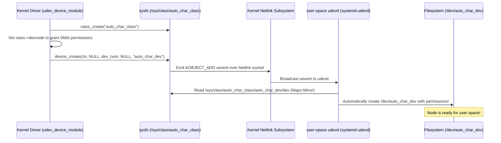

# Chapter 06: Dynamic Device Node Creation (`class_create` & udev)

In Chapter 05, after loading `cdev_module.ko`, we had to manually run:
```bash
sudo mknod /dev/cdev_buffer_dev c 248 0
sudo chmod 666 /dev/cdev_buffer_dev
```
While `mknod` is educational, no modern Linux system requires users or administrators to manually create `/dev` device nodes when connecting hardware or loading modules.

Instead, the Linux device model automates node creation through **Sysfs device classes** and the user-space **udev** daemon (`systemd-udevd`).

In this lab, we build a driver that automatically causes `/dev/auto_char_dev` to materialize the moment the module is loaded, with `0666` permissions allowing unprivileged access, and automatically disappear when unloaded!

---

## 1. How Dynamic Node Creation Works



---

## 2. Kernel Code Breakdown

### A. Creating the Device Class
```c
struct class *my_class = class_create(CLASS_NAME);
if (IS_ERR(my_class)) {
    return PTR_ERR(my_class);
}
```
- In modern Linux (kernel 6.4+ and 7.x+), `class_create` takes just the class name.
- It creates a directory under `/sys/class/auto_char_class/`.
- Checked using `IS_ERR()` and `PTR_ERR()`.

### B. Automatically Granting Permissions via `devnode`
By default, udev assigns root-only permissions (`0600` or `0660`). We override this by registering a `devnode` callback in the class:
```c
static char *auto_devnode(const struct device *dev, umode_t *mode)
{
    if (mode) {
        *mode = 0666; // rw-rw-rw-
    }
    return NULL;
}
my_class->devnode = auto_devnode;
```

### C. Creating the Device Node
```c
struct device *my_device = device_create(my_class, NULL, dev_num, NULL, DEVICE_NAME);
if (IS_ERR(my_device)) {
    // Handle error...
}
```
- Emits a netlink broadcast notifying `udevd`.
- `udevd` creates `/dev/auto_char_dev` with the major and minor numbers allocated to `dev_num`.

### D. Canonical Error Rollback (`goto` Pattern)
In kernel space, there are no C++ exceptions or try/catch blocks. If resource allocation fails at step 4, steps 1, 2, and 3 must be undone in reverse order:
```c
    ret = alloc_chrdev_region(...);
    if (ret) return ret;

    ret = cdev_add(...);
    if (ret) goto err_unregister;

    cls = class_create(...);
    if (IS_ERR(cls)) goto err_cdev_del;

    dev = device_create(...);
    if (IS_ERR(dev)) goto err_class_destroy;

    return 0;

err_class_destroy:
    class_destroy(cls);
err_cdev_del:
    cdev_del(&cdev);
err_unregister:
    unregister_chrdev_region(dev_num, 1);
    return ret;
```

---

## 3. Hands-on Lab Walkthrough

### Step 1: Compile the Module and Client
```bash
make
```

### Step 2: Load the Driver
```bash
make load
```

Watch the terminal output:
```text
===> Loading udev_device_module...
sudo insmod udev_device_module.ko
===> Node status in /dev (Notice: No mknod was run!):
crw-rw-rw- 1 root root 248, 0 Oct 22 20:25 /dev/auto_char_dev
```
*Notice how `/dev/auto_char_dev` appeared automatically with `crw-rw-rw-` permissions!*

---

### Step 3: Inspect Sysfs Class Hierarchy
```bash
make check_sysfs
```
Output:
```text
/sys/class/auto_char_class/auto_char_dev:
dev -> Contains Major:Minor (248:0)
subsystem -> Symlink to /sys/class/auto_char_class
uevent -> Device environment attributes
```

---

### Step 4: Run the Unprivileged Test Client
Notice you do **NOT** need `sudo` to run the test:
```bash
make test
```
*(Executes `./test_client`)*

**Output**:
```text
====================================================
User-Space Client: Testing Auto-Created Device Node
====================================================
[+] /dev/auto_char_dev exists in filesystem!
    Permissions: 666 (Octal)
    Device Major: 248, Minor: 0

[1] Opening /dev/auto_char_dev (unprivileged access)...
[+] Successfully opened device (fd = 3)

[2] Writing test payload: "udev automatic device creation works flawlessly!"
[+] Wrote 48 bytes

[3] Read back from kernel driver: "udev automatic device creation works flawlessly!" (48 bytes)

[SUCCESS] Verified round-trip I/O on auto-created node!
====================================================
```

---

### Step 5: Unload and Verify Dynamic Cleanup
```bash
make unload
```

Check the output:
```text
===> Unloading udev_device_module...
sudo rmmod udev_device_module
===> Confirming /dev/auto_char_dev was removed automatically by udev:
SUCCESS: /dev/auto_char_dev vanished cleanly!
```
*The kernel sent a `KOBJECT_REMOVE` uevent, and `udevd` automatically unlinked the file node from `/dev/`!*
