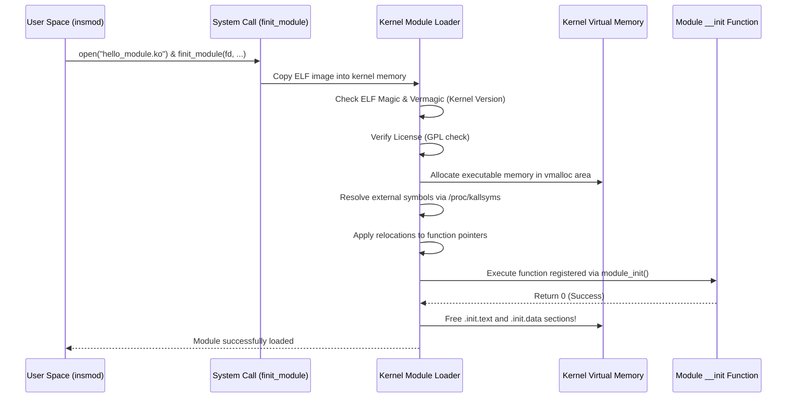

# Chapter 01: Linux Kernel Module Architecture & Lifecycle

Understanding how the Linux kernel executes code requires stepping outside the comfortable sandbox of user-space programming. In this chapter, we explore how code transitions into **Ring 0 (Supervisor Mode)**, how Loadable Kernel Modules (LKMs) function, what happens during module loading at the binary level, and how kernel logging operates.

---

## 1. Operating Modes & Privilege Rings

Modern microprocessors enforce hardware-level privilege separation using privilege rings (typically 4 rings in x86 architecture, though Linux utilizes Ring 0 and Ring 3):

```
+--------------------------------------------------------+
|                      RING 3 (User Space)               |
|   Applications, Web Browsers, Shells, Daemons, Libc    |
|   - Restricted instructions (cannot disable interrupts)|
|   - Isolated virtual address space (per-process MMU)   |
+--------------------------------------------------------+
                           |
                     System Calls
            (syscall / sysenter / int 0x80)
                           |
                           v
+--------------------------------------------------------+
|                     RING 0 (Kernel Space)              |
|   Linux Monolithic Core: Scheduler, VFS, Memory Mgr   |
|   + Loadable Kernel Modules (Device Drivers)           |
|   - Unrestricted hardware access (I/O ports, registers)|
|   - Shared kernel address space                        |
|   - No safety net: bad pointer = Kernel Panic / Oops   |
+--------------------------------------------------------+
```

### Key Differences: User Space vs. Kernel Space

| Feature | User Space (Ring 3) | Kernel Space (Ring 0) |
| :--- | :--- | :--- |
| **Execution Mode** | Unprivileged | Privileged (Supervisor) |
| **Memory Isolation**| Private address space per process | Single shared address space across all drivers |
| **Crash Impact** | Process crashes with `SIGSEGV` | System freezes, triggers Oops or Kernel Panic |
| **Runtime Library** | Standard C Library (libc, glibc, musl)| **None**. No standard libc. Kernel internal APIs only |
| **Stack Size** | Multi-Megabyte (default 8MB on Linux)| Extremely small (typically **8 KB to 16 KB**) |
| **Floating Point** | Fully supported (hardware FPU) | Strictly avoided; FPU registers are not saved on ISRs |
| **Preemption** | Managed transparently by scheduler | Controlled; drivers must handle concurrency explicitly |

---

## 2. Monolithic Kernels and Loadable Kernel Modules (LKMs)

Operating systems broadly follow one of two design philosophies:
1. **Microkernels** (e.g., seL4, Minix, QNX): The kernel core contains only IPC, basic scheduling, and virtual memory. Drivers run in user space. (Clean separation, but high IPC overhead).
2. **Monolithic Kernels** (e.g., Linux): All subsystem services, filesystems, networking stacks, and device drivers run inside Ring 0 in a single address space. This provides peak performance and zero-cost inter-subsystem calls.

To prevent having to rebuild and reboot the kernel every time hardware changes, Linux uses **Loadable Kernel Modules (LKMs)**:
- LKMs are compiled as relocatable ELF object files (`.ko`).
- They can be dynamically loaded and linked into the running kernel using `insmod` or `modprobe`.
- Once loaded, module code runs with identical privileges and speed to the rest of the kernel core.
- When unloaded with `rmmod`, the kernel frees all memory held by the module.

---

## 3. What Happens During `insmod`? (Under the Hood)

When you execute `sudo insmod hello_module.ko`, the following sequence takes place:



### ELF Section Discarding (`__init` and `__exit`)
Notice how memory is conserved:
- Functions annotated with `__init` (like `hello_init`) and variables annotated with `__initdata` are grouped by the compiler into `.init.text` and `.init.data`.
- Once `hello_init()` completes, the kernel frees those pages immediately back to the OS memory allocator.
- The `__exit` function is placed into `.exit.text`. If the module is compiled statically into the kernel (`obj-y`), the build system strips this section entirely since static drivers can never be unloaded.

---

## 4. Modern Kernel Logging vs. Legacy `printk`

In user space, debugging often starts with `printf()`. In the kernel, output is written to a circular memory buffer called the **Kernel Ring Buffer** using `printk()`.

### The 8 Kernel Log Levels

The kernel classifies messages into 8 log levels defined in `<linux/kern_levels.h>`:

| Level Macro | Integer Value | Description |
| :--- | :--- | :--- |
| `KERN_EMERG` | `0` | System is unusable (highest urgency) |
| `KERN_ALERT` | `1` | Action must be taken immediately |
| `KERN_CRIT` | `2` | Critical conditions (hardware failures) |
| `KERN_ERR` | `3` | Error conditions (failed driver probe, missing device) |
| `KERN_WARNING` | `4` | Warning conditions |
| `KERN_NOTICE` | `5` | Normal but significant condition |
| `KERN_INFO` | `6` | Informational messages (module loaded, device detected) |
| `KERN_DEBUG` | `7` | Debug-level messages |

### The Modern Way: `pr_fmt` and `pr_*` Macros
Legacy drivers wrote:
```c
printk(KERN_INFO "my_driver: Device registered\n");
```

Modern kernel code uses the streamlined `pr_*` macros (`pr_info`, `pr_err`, `pr_warn`, `pr_debug`) combined with `pr_fmt`:

```c
#define pr_fmt(fmt) KBUILD_MODNAME ": " fmt
#include <linux/kernel.h>

pr_info("Device initialized successfully\n");
// Outputs in dmesg as: "my_driver: Device initialized successfully"
```

### Viewing Logs
- View the entire ring buffer:
  ```bash
  sudo dmesg
  ```
- Follow live kernel messages in real time:
  ```bash
  sudo dmesg -w
  ```
- Filter by human-readable timestamp:
  ```bash
  sudo dmesg -T
  ```

---

## 5. The Kbuild System & Out-of-Tree Compilation

Linux modules cannot be compiled using standard `gcc hello.c -o hello.ko`. Kernel modules require:
1. Exact kernel C preprocessor defines (`-D__KERNEL__`).
2. Architecture-specific compiler flags (`-mno-red-zone`, `-mcmodel=kernel`, specific optimization flags).
3. The kernel's internal header tree.

The kernel provides **Kbuild** for this. An out-of-tree Makefile delegates compilation to the kernel's build directory:

```makefile
obj-m := hello_module.o

KDIR := /lib/modules/$(shell uname -r)/build
PWD  := $(shell pwd)

all:
	$(MAKE) -C $(KDIR) M=$(PWD) modules
```

- `-C $(KDIR)` changes directory into the official kernel headers directory where the top-level kernel Makefile resides.
- `M=$(PWD)` tells Kbuild to build the external module located in our directory.
- `obj-m` declares that the target object file should be built as a loadable module (`m`).

### Generated Build Artifacts
When Kbuild compiles a module, several intermediate files are created:
- `hello_module.o`: The compiled object file of your C source code.
- `hello_module.mod.c`: Auto-generated C file containing module metadata, module version string (vermagic), and symbol dependencies.
- `hello_module.mod.o`: Compiled version of `hello_module.mod.c`.
- `Module.symvers`: Symbol versions of exported symbols.
- `modules.order`: The order in which modules should be loaded if multiple exist.
- `hello_module.ko`: The final linked kernel object ready for `insmod`.

---

## 6. Critical Rules for Kernel Programmers

1. **Never Sleep in Atomic / Interrupt Context**: If you hold a spinlock or are executing inside an interrupt handler, you must NEVER call functions that might put the calling thread to sleep (e.g., `msleep()`, `mutex_lock()`, `alloc_pages(GFP_KERNEL)`). Doing so triggers a kernel freeze or panic.
2. **Beware the Stack Limit**: The kernel stack is small (8 KB on 32-bit, 16 KB on 64-bit). Allocating large local buffers like `char buffer[8192];` inside a function will cause a silent stack overflow into adjacent kernel memory structures (`thread_info` / `task_struct`).
3. **Verify Every User Pointer**: Never dereference a user-space pointer directly! User space memory can be paged out, unmapped, or malicious. Always use `copy_from_user()` and `copy_to_user()`.
4. **Clean Up in Reverse Order**: If module initialization fails halfway through allocating resources, you must cleanly release everything allocated up to that failure point before returning the error code.
