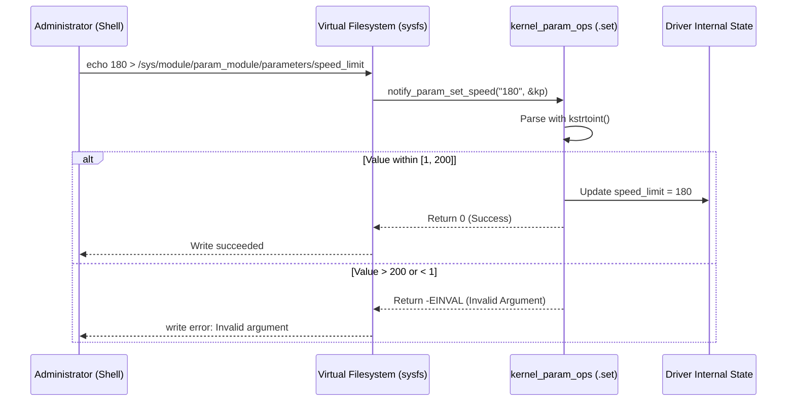

# Chapter 02: Module Parameters & The Sysfs Architecture

Kernel drivers rarely operate in an isolated environment with static configuration. Real-world hardware varies in clock frequencies, bus addresses, IRQ lines, and operating modes. In this chapter, we explore how the Linux kernel passes parameters to drivers at load time and how the **Sysfs Virtual Filesystem** allows dynamic runtime introspection and configuration.

---

## 1. How Module Parameters Work at the Binary Level

When you declare a parameter in a driver:
```c
static int baud_rate = 115200;
module_param(baud_rate, int, 0644);
```

The `module_param()` macro does not just declare a variable. Behind the scenes, it instructs the compiler to generate a `struct kernel_param` entry and place it into a dedicated ELF section named `__param`:

```
+--------------------------------------------------------------+
|                     Compiled .ko ELF Binary                  |
+--------------------------------------------------------------+
|  .text         | Executable driver machine instructions      |
|  .data / .bss  | Global variables (e.g., int baud_rate)       |
|  .init.text    | Module initialization code (__init)         |
|  __param       | Array of `struct kernel_param` metadata:    |
|                |   - Name string: "baud_rate"                |
|                |   - Pointer to variable: &baud_rate         |
|                |   - Pointer to ops: &param_ops_int          |
|                |   - Sysfs permissions: 0644                 |
+--------------------------------------------------------------+
```

### The Load-Time Parsing Flow
When `insmod mydriver.ko baud_rate=9600` is run:
1. The kernel module loader copies the module into kernel space.
2. Before invoking `module_init()`, the loader parses the command line string passed by the user.
3. It iterates through the driver's `__param` ELF section matching parameter names.
4. When a match is found, it invokes the associated type parser (e.g., `param_ops_int.set()`), converting the ASCII string `"9600"` into integer `9600` and writing it directly to `baud_rate`.
5. Only after all parameters are validated and set does the kernel call the module's `init` function.

---

## 2. The Sysfs Virtual Filesystem (`/sys`)

Sysfs is an in-memory virtual filesystem introduced in Linux 2.6 and mounted at `/sys`. Its primary purpose is to expose the kernel's internal object hierarchy (`kobjects`) to user space as a clean, hierarchical directory tree.

```
/sys/
├── block/             # Block devices (nvme, sda, etc.)
├── bus/               # Physical and virtual buses (pci, usb, i2c, platform)
├── class/             # Device classes (net, tty, gpio, drm)
├── dev/               # Lookup table for major:minor numbers
├── devices/           # Unified device tree (hardware representation)
└── module/            # Loaded kernel modules & their runtime parameters
    └── param_module/
        ├── holders/
        ├── notes/
        ├── parameters/
        │   ├── device_tag       (0444 - RO)
        │   ├── sample_rate      (0644 - RW)
        │   ├── speed_limit      (0644 - RW with custom callbacks)
        │   └── threshold_levels (0644 - RW array)
        ├── refcnt
        ├── sections/
        └── uevent
```

### File Permissions & `VERIFY_OCTAL_PERMISSIONS`
The third argument of `module_param(name, type, perm)` sets the file mode bits inside `/sys/module/<modname>/parameters/`:

| Permission | Octal | Meaning |
| :--- | :---: | :--- |
| `0` | `0000` | Hidden. Parameter can only be passed at `insmod` time; no sysfs file is created. |
| `S_IRUGO` | `0444` | Read-only by everyone. Cannot be written to at runtime. |
| `S_IRUGO \| S_IWUSR` | `0644` | Readable by all; writable only by root (`sudo`). |

> [!CAUTION]
> **World-Writable Security Ban**:
> The kernel macro `VERIFY_OCTAL_PERMISSIONS` checks permission bits at compile time. If you attempt to specify `0666` or `0777` (world-writable), the kernel build will intentionally fail:
> ```text
> BUILD_BUG_ON_ZERO((perm) & 022)
> ```
> Unprivileged users must never be allowed to directly modify arbitrary kernel driver state.

---

## 3. String Conversion & Safe Number Parsing

In older kernel versions, developers frequently used `simple_strtol()` or `sscanf()`. These functions are now deprecated because they silently ignore integer overflow and do not reliably report invalid non-numeric trailing garbage.

Modern kernel code uses the `kstrto*` family declared in `<linux/kernel.h>`:

```c
int kstrtoint(const char *s, unsigned int base, int *res);
int kstrtol(const char *s, unsigned int base, long *res);
int kstrtou32(const char *s, unsigned int base, u32 *res);
int kstrtobool(const char *s, bool *res);
```

- Returns `0` on success.
- Returns `-EINVAL` if non-numeric characters are found.
- Returns `-ERANGE` if the value overflows or underflows the target variable size.

---

## 4. Custom Parameter Callbacks (`kernel_param_ops`)

Standard parameters (`module_param`) simply assign a variable in RAM. They do not notify your driver when a value changes in sysfs.

When your driver needs to react immediately (e.g. notify hardware, allocate memory, or validate allowed ranges), use `module_param_cb()` with a custom `struct kernel_param_ops`:



### Signature of Custom Ops Callbacks
```c
struct kernel_param_ops {
    int (*set)(const char *val, const struct kernel_param *kp);
    int (*get)(char *buffer, const struct kernel_param *kp);
    void (*free)(void *arg);
};
```
- `.set`: Called on `echo <val> > sysfs_file`. Returns `0` on success, or negative error code (e.g., `-EINVAL`).
- `.get`: Called on `cat sysfs_file`. Fills `buffer` (max `PAGE_SIZE`, 4KB) with a string representation and returns the number of bytes written.
- `.free`: Optional callback to clean up allocated memory.

---

## 5. Summary & Best Practices

1. **Document Every Parameter**: Always include `MODULE_PARM_DESC()` so users can understand options using `modinfo -p`.
2. **Never Trust User Input**: Even though writing to sysfs requires root, administrators make typos. Always validate numeric bounds using custom callbacks before modifying hardware states.
3. **Keep sysfs Callbacks Fast**: Sysfs read/write operations hold VFS subsystem locks; do not perform lengthy blocking I/O inside `.set` callbacks.
