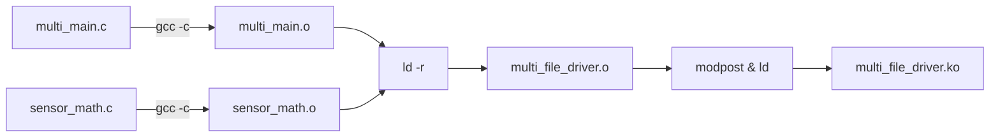
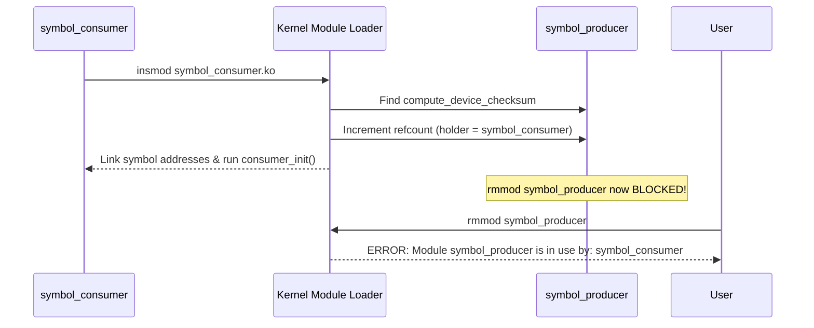

# Chapter 03: Multi-File Modules, Symbol Export & Dependency Resolution

In real-world Linux kernel development, device drivers rarely live in a single `.c` file, nor do they operate in total isolation from other drivers. 

In this chapter, we explore how the kernel linker stitches together multi-file drivers, how symbols are exported into the kernel symbol table, the legal and technical implications of `EXPORT_SYMBOL_GPL()`, and how the kernel tracks inter-module dependencies.

---

## 1. Multi-File Compilation in Kbuild

When building a driver composed of multiple source files (e.g., `multi_main.c` and `sensor_math.c`), Kbuild uses partial linking (`ld -r` or `ld -melf_x86_64 -r`) to combine multiple `.o` object files into a single composite relocatable object file before creating the `.ko`.



### The Kbuild Rule Syntax
```makefile
obj-m := multi_file_driver.o
multi_file_driver-objs := multi_main.o sensor_math.o
```
- `obj-m := <module_name>.o` declares the target module name.
- `<module_name>-objs := <file1>.o <file2>.o` declares the list of object files that compose it.
- **Critical rule**: You must NOT name any of the `.c` files `<module_name>.c` (e.g., having `multi_file_driver.c` alongside `multi_file_driver-objs` will trigger infinite circular make targets or overwriting collisions).

---

## 2. The Kernel Symbol Table & Symbol Export

By default, symbols (functions and global variables) defined in a kernel module are private to that module—other modules cannot see or link against them.

To make a function or variable accessible to other kernel modules, you must explicitly export it using one of two macros from `<linux/export.h>`:

```c
EXPORT_SYMBOL(symbol_name);
// OR
EXPORT_SYMBOL_GPL(symbol_name);
```

### `EXPORT_SYMBOL` vs. `EXPORT_SYMBOL_GPL`

| Macro | Accessibility | Legal / Architectural Intent |
| :--- | :--- | :--- |
| `EXPORT_SYMBOL()` | Accessible to **ANY** module, including proprietary/closed-source binary modules. | Used for generic, standard interfaces (e.g., basic string helpers, fundamental VFS functions). |
| `EXPORT_SYMBOL_GPL()` | Accessible **ONLY** to modules with a GPL-compatible `MODULE_LICENSE()` (e.g., "GPL", "GPL v2", "Dual BSD/GPL"). | Used for deep, internal kernel interfaces. Ensures proprietary binary blobs cannot hook into sensitive kernel subsystems without violating license boundaries. |

### What the Kernel Does at Compile Time: `__ksymtab`
When you write `EXPORT_SYMBOL_GPL(my_function)`, Kbuild creates a `struct kernel_symbol` entry in a dedicated ELF section:
- `__ksymtab_gpl`: Stores the memory pointer to the symbol.
- `__kstrtab_gpl`: Stores the ASCII name of the symbol (`"my_function"`).

When the module is loaded, the kernel loader copies these entries into the live **Kernel Symbol Table**.

---

## 3. Symbol Inspection via `/proc/kallsyms`

Every active symbol in the kernel (both built-in and loaded via LKMs) can be inspected via `/proc/kallsyms`:

```bash
sudo grep "compute_device_checksum" /proc/kallsyms
```

Output:
```text
ffffffffc0892000 T compute_device_checksum [symbol_producer]
```
- Column 1: The virtual memory address of the function.
- Column 2: Symbol type (`T` = global text/code, `D` = global initialized data, `r` = read-only data).
- Column 3: The symbol name.
- Column 4: The owning module name (`[symbol_producer]`).

---

## 4. Symbol Versioning & `Module.symvers` (`CONFIG_MODVERSIONS`)

What happens if Driver A exports a function:
```c
int read_temp(int sensor_id);
```
And Driver B compiles against it. Later, a developer changes Driver A to:
```c
int read_temp(int sensor_id, int timeout_ms);
```
If Driver B attempts to call `read_temp` with only one argument, the stack frame will corrupt and the kernel will crash.

To prevent this, Linux uses **Module Versioning (Modversions)**:
1. During compilation, the `genksyms` tool generates a 32-bit CRC checksum based on the exact type signature of each exported function and variable.
2. These CRCs are written to `Module.symvers`:
   ```text
   0x1a2b3c4d   compute_device_checksum   symbol_producer   EXPORT_SYMBOL_GPL
   ```
3. When Driver B compiles against Driver A, Driver B embeds that expected CRC into its binary.
4. When `insmod Driver B` is executed, the kernel verifies that the CRC in Driver B matches the CRC in the loaded Driver A. If they differ, the kernel refuses to load the module with an ABI mismatch error.

---

## 5. Module Reference Counting & Dependency Tracking

When `symbol_consumer.ko` is loaded, the kernel loader detects that it resolves symbols from `symbol_producer.ko`.



### Safe Lifecycle Invariant:
- A producer module cannot be unloaded until **all** consumer modules have first been cleanly unloaded.
- This prevents dangling pointers in Ring 0 where code jumps into memory that has already been freed.

---

## 6. `insmod` vs. `modprobe`

Throughout these labs, we use `insmod` and `rmmod` because they are explicit and educational:

- **`insmod`**: A low-level utility that takes a direct filepath (`insmod path/to/driver.ko`) and invokes the `finit_module` system call. It does **NOT** resolve dependencies; if a prerequisite module is missing, it simply fails with `Unknown symbol in module`.
- **`modprobe`**: A high-level system utility. It consults `/lib/modules/$(uname -r)/modules.dep` (generated by `depmod`). If you run `modprobe symbol_consumer`, `modprobe` automatically figures out that `symbol_producer` must be loaded first, loads the producer, and then loads the consumer!
