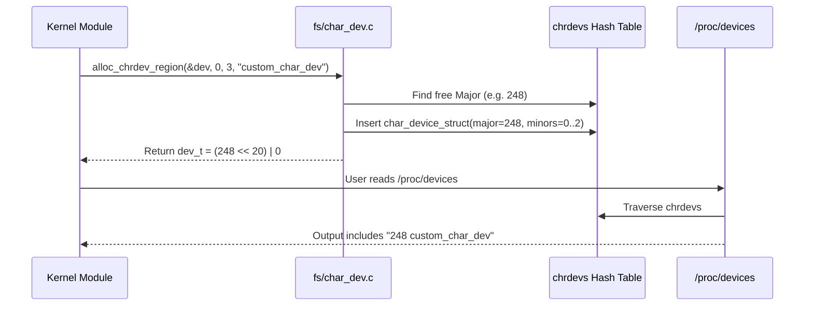

# Chapter 04: Character Device Fundamentals & Device Numbers

In the Unix and Linux operating system philosophy, hardware peripherals are integrated seamlessly into the file system namespace under `/dev`. A user-space application interacts with hardware using the same system calls used for regular files: `open()`, `read()`, `write()`, `ioctl()`, and `close()`.

To route system calls from a `/dev/xyz` file node to the appropriate device driver in Ring 0, the kernel relies on **Device Numbers** (`dev_t`).

---

## 1. The Three Primary Classes of Linux Devices

The Linux kernel categorizes hardware into three fundamental classes:

```
                      +-----------------------------+
                      |   Linux Hardware Classes    |
                      +-----------------------------+
                                     |
         +---------------------------+---------------------------+
         |                           |                           |
         v                           v                           v
+------------------+        +------------------+        +------------------+
| Character Devices|        |  Block Devices   |        | Network Devices  |
| (Stream of bytes)|        | (Random blocks)  |        | (Packet streams) |
| - tty, keyboard  |        | - SSD, NVMe, HDD |        | - eth0, wlan0    |
| - ADC, sensors   |        | - Filesystems    |        | - Socket buffers |
| - /dev/ node     |        | - /dev/ node     |        | - No /dev/ node  |
+------------------+        +------------------+        +------------------+
```

1. **Character Devices (Char Devs)**: Data is transferred as an unbuffered, sequential stream of bytes. Seeking (`lseek`) may or may not be supported depending on hardware.
2. **Block Devices**: Data is transferred in fixed-size blocks (typically 512B to 4KB). Transfers go through the Linux **Page Cache** and request queues, and random-access seeking is fully supported.
3. **Network Devices**: Driven by packet transmission engines (`struct net_device`). Network interfaces do not have `/dev` filesystem nodes; they are addressed via socket interfaces (`bind()`, `sendto()`).

---

## 2. Anatomy of `dev_t` (Major & Minor Numbers)

In the kernel, a device number is encapsulated by the `dev_t` type (defined in `<linux/types.h>` as a 32-bit unsigned integer `u32`):

```
+------------------------------------+------------------------------------+
|       12 bits: MAJOR NUMBER        |       20 bits: MINOR NUMBER        |
|      (Range: 0 to 4,095)           |      (Range: 0 to 1,048,575)       |
+------------------------------------+------------------------------------+
 31                                20 19                                 0
```

### Purpose of Major and Minor Numbers

- **Major Number (12 bits)**:
  - Identifies the **driver** responsible for controlling the device.
  - The kernel uses the major number as an index into the character device hash table (`chrdevs`).
- **Minor Number (20 bits)**:
  - Identifies the **individual device instance** or sub-channel managed by that driver.
  - For example, if a company manufactures a 4-channel analog-to-digital converter, all 4 channels share the same Major number (same driver), but channel 0 has Minor 0, channel 1 has Minor 1, etc.

### Bit Manipulation Macros (`<linux/kdev_t.h>`)
Never manipulate bits directly with shift operators; always use the kernel macros:
```c
dev_t dev = MKDEV(248, 0);   // Pack major 248 and minor 0 into a dev_t
int major = MAJOR(dev);       // Unpack major (248)
int minor = MINOR(dev);       // Unpack minor (0)
```

---

## 3. Kernel Internal Registration: `chrdevs` Table

Inside the kernel filesystem core (`fs/char_dev.c`), character devices are registered in an internal hash table:

```c
static struct char_device_struct {
    struct char_device_struct *next;
    unsigned int major;
    unsigned int baseminor;
    int minorct;
    char name[64];
    struct cdev *cdev;        /* will be covered in Chapter 05 */
} *chrdevs[CHRDEV_MAJOR_HASH_SIZE];
```

When you call:
```c
alloc_chrdev_region(&dev_num, 0, 3, "custom_char_dev");
```
1. The kernel locks the `chrdevs` mutex.
2. It searches the hash table starting from major 255 downward for an unallocated major number.
3. It allocates a `struct char_device_struct` recording the assigned range (`major`, `baseminor=0`, `minorct=3`, `name="custom_char_dev"`).
4. It inserts this descriptor into `chrdevs`.
5. This registration is what `/proc/devices` iterates over when you read `/proc/devices`.



---

## 4. Static vs. Dynamic Allocation

| Feature | Static (`register_chrdev_region`) | Dynamic (`alloc_chrdev_region`) |
| :--- | :--- | :--- |
| **Selection** | Hardcoded by driver developer | Assigned at runtime by the kernel |
| **Conflict Risk** | High; if another driver claimed the number, loading fails (`-EBUSY`) | Zero conflict; kernel guarantees uniqueness |
| **Portability** | Poor across different Linux distributions | Flawless across all architectures & distros |
| **Best Practice** | Legacy; only used when standard major numbers are reserved by POSIX/LANANA | **Industry Standard** for all modern drivers |

---

## 5. Summary & Next Step

Allocating a device number reserves an identity in the kernel's namespace, but it does **not** yet create a device node in `/dev`, nor does it connect user-space system calls (`open`, `read`, `write`) to driver code.

In **Chapter 05**, we will connect this `dev_t` to a **`struct cdev`** and implement our first **`struct file_operations`** table!
