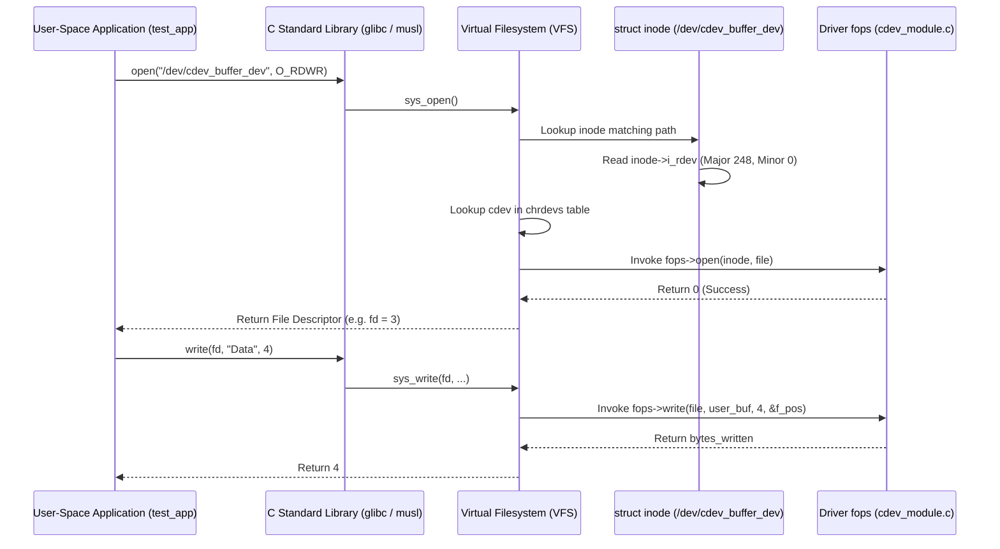

# Chapter 05: The VFS, `struct cdev`, and `file_operations`

When an application calls `read(fd, buf, count)` in user space, that call journeys through the POSIX C library, traverses the Linux **Virtual Filesystem (VFS)** layer in Ring 0, and dispatches the exact function pointer defined by our driver.

In this chapter, we explore how the kernel maps file descriptors to character drivers using **`struct inode`**, **`struct file`**, **`struct cdev`**, and **`struct file_operations`**.

---

## 1. The VFS Journey: From User Space to Device Driver



---

## 2. Core Kernel Structures: `struct inode` vs. `struct file`

New kernel driver developers often confuse `struct inode` and `struct file`. They represent two entirely different concepts:

| Feature | `struct inode` | `struct file` |
| :--- | :--- | :--- |
| **What it Represents** | The **static entity** on the filesystem (e.g., `/dev/cdev_buffer_dev`). | The **dynamic open instance** created when a process calls `open()`. |
| **Quantity** | **Only ONE** inode exists in RAM per file/node. | **Multiple** files can exist if multiple processes open the same file simultaneously. |
| **Key Fields** | - `i_rdev`: The raw `dev_t` device number.<br>- `i_cdev`: Pointer to the registered `struct cdev`.<br>- `i_mode`: File permissions (`S_IFCHR`). | - `f_pos`: Current file read/write offset (position cursor).<br>- `f_flags`: Access flags (`O_RDONLY`, `O_NONBLOCK`).<br>- `private_data`: Pointer reserved for driver custom data. |
| **Lifecycle** | Stays cached in memory until unlinked. | Destroyed when the process calls `close()` (or exits). |

---

## 3. The `container_of()` Pattern

In professional Linux drivers, `struct cdev` is not allocated as a loose global variable. Instead, it is embedded directly inside a custom driver state structure:

```c
struct my_device_data {
    dev_t dev_num;
    char buffer[1024];
    int active_sessions;
    struct cdev cdev;  // Embedded cdev
};
```

When user space opens the device, the VFS passes `struct inode *inode` to `dev_open()`.
The inode contains `inode->i_cdev`, which points to `&my_data.cdev`. 

How do we get the address of the parent `struct my_device_data` from the pointer to its inner member?

We use the kernel's **`container_of()`** macro declared in `<linux/kernel.h>`:

```c
struct my_device_data *data = container_of(inode->i_cdev, struct my_device_data, cdev);
file->private_data = data;
```

### How `container_of` Works Under the Hood
```c
#define container_of(ptr, type, member) ({                      \
    const typeof( ((type *)0)->member ) *__mptr = (ptr);        \
    (type *)( (char *)__mptr - offsetof(type,member) );})
```
By taking the pointer to the member and subtracting the byte offset of that member within the parent struct, it calculates the base memory address with zero overhead!

---

## 4. Safe Memory Access: `copy_to_user` and `copy_from_user`

### Why Direct Pointer Dereferencing Crashes the Kernel

In user space, writing to a buffer is simply:
```c
*buf = 'A';
```
If you do this in kernel space with a user-provided pointer:
```c
*user_buf = 'A'; // DANGEROUS! NEVER DO THIS!
```
This can freeze or crash the machine because:
1. **Paging / Virtual Memory**: User pages might not be in physical RAM; they might be paged out to swap disk. Dereferencing causes an unhandled page fault.
2. **SMAP (Supervisor Mode Access Prevention)**: Modern x86 processors enforce hardware protections that prevent Ring 0 instructions from directly accessing Ring 3 memory pages unless an explicit override instruction (`stac`/`clac`) is executed.
3. **Security Vulnerabilities**: A malicious user space program could pass a kernel address (e.g., `0xffff8800...`) into `read()`, tricking the kernel into overwriting its own routing tables or credentials!

### The Safe Way:
```c
// To send data from Kernel -> User
unsigned long not_copied = copy_to_user(user_dest, kernel_src, bytes);

// To receive data from User -> Kernel
unsigned long not_copied = copy_from_user(kernel_dest, user_src, bytes);
```

Under the hood, these functions:
- Validate that the destination/source pointer belongs to valid user space (`access_ok()`).
- Handle hardware SMAP instructions.
- Safely capture and recover from page faults without panicking the kernel.
- Return the number of bytes that could **NOT** be copied (returns `0` on 100% success).

---

## 5. The Critical `cdev_add` Ordering Rule

A common beginner mistake is initializing driver data structures *after* calling `cdev_add()`:

```c
// DANGEROUS CODE PATTERN:
cdev_add(&dev->cdev, dev_num, 1);
dev->buffer = kmalloc(1024, GFP_KERNEL); // RACE CONDITION BUG!
```

### Why this is a bug:
Linux is a multi-core (SMP), preemptive operating system. The moment `cdev_add()` returns, the driver is **immediately live**. A user-space daemon or script might open `/dev/mydev` and issue a `read()` before the next line of code runs, resulting in a NULL pointer dereference crash!

**Rule**: Always initialize every lock, allocate every buffer, and setup all state **BEFORE** calling `cdev_add()`.
