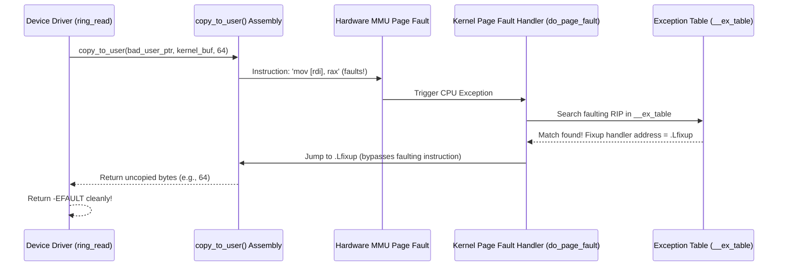

# Chapter 07: Kernel Memory Access & Circular Ring Buffers

Transferring data between user space and kernel space is one of the most security-sensitive operations in device driver engineering. A single unchecked pointer dereference can allow unprivileged attackers to gain root access, leak kernel memory, or crash the operating system.

In this chapter, we explore how the Linux kernel isolates address spaces, how `copy_to_user()` and `copy_from_user()` catch hardware page faults using the **Exception Fixup Table (`__ex_table`)**, and how to architect **Circular FIFO Ring Buffers** for high-throughput streaming drivers.

---

## 1. Virtual Address Space Partitioning

On 64-bit architectures (x86_64), the CPU uses 48-bit (or 57-bit) virtual addressing, partitioning the 64-bit space into two halves with a non-canonical gap in between:

```
+--------------------------------------------------------------+ 0xFFFFFFFFFFFFFFFF
|                      KERNEL SPACE (Ring 0)                   |
|   - Direct-mapped physical RAM, vmalloc, modules, BPF        |
|   - Shared across all processes in the system                |
+--------------------------------------------------------------+ 0xFFFF800000000000
|                                                              |
|                 Non-Canonical Addressing Gap                 |
|                                                              |
+--------------------------------------------------------------+ 0x00007FFFFFFFFFFF
|                      USER SPACE (Ring 3)                     |
|   - Application code, stack, heap, shared libraries (libc)   |
|   - Unique per-process page tables (swapped on context switch)|
+--------------------------------------------------------------+ 0x0000000000000000
```

### Why User Pointers Cannot Be Trusted in Kernel Space
1. **Per-Process Page Tables**: A user address (e.g. `0x7ffcd340`) is only valid within the context of the currently running process. If a driver stores that pointer and dereferences it later inside an interrupt handler or kernel thread, that address maps to completely different memory or nothing at all!
2. **Page Faults on Paged-Out Memory**: User-space memory can be uncommitted or paged out to swap disk. A direct dereference triggers a page fault. If the driver holds a spinlock or is in interrupt context, sleeping to wait for disk I/O will instantly freeze the machine.
3. **SMAP (Supervisor Mode Access Prevention)**: Modern x86 processors enforce hardware protections where any Ring 0 instruction that attempts to read/write a Ring 3 address will immediately trigger a General Protection Fault (`#GP`) unless temporarily unlocked.

---

## 2. Under the Hood: The Exception Fixup Table (`__ex_table`)

How does `copy_from_user()` safely attempt to read user memory without crashing the kernel if the pointer is invalid?

The kernel uses a mechanism called **Exception Tables**:



### The Fixup Table Entry
In the compiled kernel ELF binary, every load/store instruction inside `copy_from_user` has a matching entry in a special section named `__ex_table`:
```c
struct exception_table_entry {
    int insn;   // Relative offset to faulting instruction
    int fixup;  // Relative offset to error handler code
};
```
When a fault occurs:
1. The kernel checks if the instruction pointer is listed in `__ex_table`.
2. If yes, it does **NOT** panic; it rewinds the CPU instruction pointer to the `fixup` label, which stores the remaining byte count and returns cleanly.
3. If no (i.e. a raw `*ptr` bug in your driver), the kernel prints an Oops and kills the process or panics!

---

## 3. Circular FIFO Ring Buffers

A linear buffer fails for streaming I/O because reading from the front leaves dead space, requiring expensive `memmove()` shifts.

A **Circular Ring Buffer** connects the end of the array back to the beginning:

```
Indices:    0    1    2    3    4    5    6    7
          +----+----+----+----+----+----+----+----+
          | D2 | D3 |    |    |    | D0 | D1 | D2 |
          +----+----+----+----+----+----+----+----+
                      ^              ^
                      Head           Tail
                 (Next Write)    (Next Read)
```

### Two-Segment Split Copy Formula
When copying $N$ bytes to or from index `pos` in a buffer of capacity $C$:
```c
size_t part1 = min(N, (size_t)(C - pos));
size_t part2 = N - part1;
```
1. **Segment 1**: Copy `part1` bytes from `pos` up to `C`.
2. **Segment 2**: If `part2 > 0`, wrap around and copy `part2` bytes starting from index `0`.

### Power-of-Two Bitwise Optimization
If $C$ is a power of 2 ($2^k$, e.g. 1024):
```c
// Instead of slow modulo arithmetic:
next_pos = (pos + count) % C;

// We use single-cycle bitwise masking:
next_pos = (pos + count) & (C - 1);
```

---

## 4. The Kernel's Built-in FIFO API: `struct kfifo`

For production drivers, the kernel provides a standardized, lockless single-producer/single-consumer FIFO in `<linux/kfifo.h>`:

```c
#include <linux/kfifo.h>

struct kfifo my_fifo;

// Initialize
kfifo_alloc(&my_fifo, 1024, GFP_KERNEL);

// Write data from user space directly into FIFO
int ret = kfifo_from_user(&my_fifo, user_buf, count, &copied);

// Read data from FIFO directly into user space
int ret = kfifo_to_user(&my_fifo, user_buf, count, &copied);

// Free
kfifo_free(&my_fifo);
```

Understanding how manual circular wrapping works (as implemented in this lab) provides the deep mathematical foundation for using `kfifo` and hardware DMA ring descriptors with confidence.
