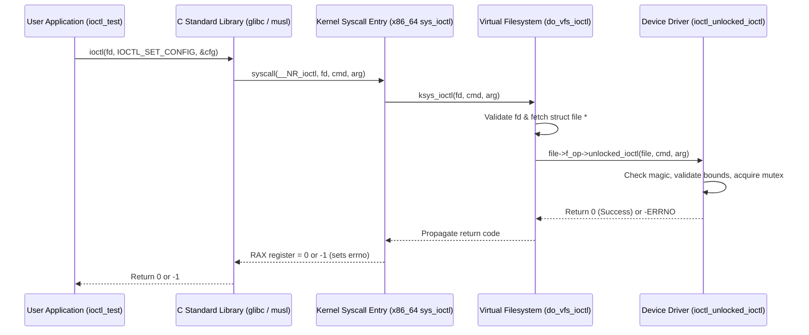

# Chapter 08: IOCTL Subsystem & Hardware Control Interfaces

In UNIX and Linux operating systems, the standard I/O abstraction models devices as linear, sequential streams of bytes accessed via `read()`, `write()`, and `lseek()`. However, physical hardware devices are rarely just passive byte streams. They possess complex operational modes, configurable clock rates, power management states, calibration routines, and asynchronous notification triggers.

The **IOCTL (Input/Output Control)** subsystem provides the official out-of-band communication bridge between user-space applications and device drivers.

---

## 1. System Call Architecture: The VFS Dispatch Path

When a user-space application issues an `ioctl()` syscall, the kernel routes the request through the Virtual Filesystem (VFS) layer directly into the driver's registered file operations:



### Evolution: Why `unlocked_ioctl` Replaced `ioctl`
Prior to Linux 2.6.36, the file operations structure used `int (*ioctl) (struct inode *, struct file *, unsigned int, unsigned long)`.
Under this legacy interface, the kernel grabbed the **Big Kernel Lock (BKL)** before invoking the driver's handler. This created severe scalability bottlenecks on multi-core systems because only one core could execute *any* driver ioctl simultaneously!

In modern kernels:
- The legacy `ioctl` callback was completely eradicated along with the BKL.
- Drivers implement `long (*unlocked_ioctl) (struct file *filp, unsigned int cmd, unsigned long arg)`.
- Drivers are explicitly responsible for their own concurrency synchronization (using mutexes, spinlocks, or read-copy-update).

---

## 2. IOCTL Command Bit-Encoding

To prevent command collisions across different drivers and enable automated parameter size checking, Linux encodes four fields into every 32-bit IOCTL command number:

```text
 31      30 29                    16 15                  8 7                  0
+----------+------------------------+---------------------+--------------------+
|   DIR    |          SIZE          |        TYPE         |         NR         |
+----------+------------------------+---------------------+--------------------+
  [2 bits]          [14 bits]               [8 bits]              [8 bits]
 Direction       Payload Size (bytes)     Magic Number         Command Number
```

### Field Definitions:
1. **Direction (`DIR` - 2 bits)**:
   - `_IOC_NONE` (0): No data transferred between user and kernel (e.g., reset, flush).
   - `_IOC_WRITE` (1): Data copied **User &rarr; Kernel** (driver reads from user buffer).
   - `_IOC_READ` (2): Data copied **Kernel &rarr; User** (driver writes to user buffer).
   - `_IOC_READ | _IOC_WRITE` (3): Bidirectional exchange.
2. **Size (`SIZE` - 14 bits)**:
   - Automatically evaluated using `sizeof(type)`. This allows the kernel or debugging tools (like `strace`) to inspect payload dimensions.
3. **Type (`TYPE` - 8 bits)**:
   - An 8-bit character code ("magic number") assigned to the driver family (e.g., `'k'` for our tutorial driver, `'T'` for tty devices, `'V'` for Video4Linux).
4. **Number (`NR` - 8 bits)**:
   - Sequential identifier for the command within this driver family (1, 2, 3...).

### Standard Macro Constructors (`<linux/ioctl.h>` / `<sys/ioctl.h>`)
```c
#define _IO(type, nr)             /* No argument */
#define _IOR(type, nr, datatype)  /* Read from driver */
#define _IOW(type, nr, datatype)  /* Write to driver */
#define _IOWR(type, nr, datatype) /* Bidirectional exchange */
```

### Decoding Helper Macros
Inside the driver, macros extract individual bitfields from `cmd`:
- `_IOC_DIR(cmd)`: Returns direction flags (`_IOC_NONE`, `_IOC_READ`, `_IOC_WRITE`).
- `_IOC_TYPE(cmd)`: Returns the 8-bit magic number.
- `_IOC_NR(cmd)`: Returns the command sequence number.
- `_IOC_SIZE(cmd)`: Returns payload size in bytes.

---

## 3. Production Error Handling & POSIX Conventions

Returning correct POSIX error codes is essential for user-space reliability and diagnostic clarity:

| Return Code | Errno Name | Standard User-Space Message | Meaning / Trigger |
| :--- | :--- | :--- | :--- |
| `0` | Success | N/A | Operation completed successfully |
| `-ENOTTY` | `ENOTTY` | "Inappropriate ioctl for device" | Unrecognized command or invalid magic number |
| `-EINVAL` | `EINVAL` | "Invalid argument" | Out-of-bounds parameter values (e.g., illegal baud rate) |
| `-EFAULT` | `EFAULT` | "Bad address" | `copy_from_user` or `copy_to_user` encountered invalid pointer |
| `-EPERM` | `EPERM` | "Operation not permitted" | Caller lacks required Linux capabilities (`CAP_SYS_ADMIN`) |
| `-EBUSY` | `EBUSY` | "Device or resource busy" | Hardware currently locked or executing exclusive command |

> [!NOTE]
> Why does an invalid IOCTL return `ENOTTY` ("Not a typewriter")?
> Historically, UNIX systems used `ioctl` primarily for controlling serial teletypewriters (TTYs). When an ioctl was sent to a file descriptor that was not a terminal or did not support that terminal command, the system returned `ENOTTY`. POSIX formalized `ENOTTY` as the standard return value for unsupported ioctl requests on any device.

---

## 4. Security & Concurrency Considerations

### 1. Privilege Escalation Prevention
Sensitive hardware configurations (e.g., flashing firmware, repartitioning hardware tables, resetting bus controllers) must be restricted to privileged administrative processes:

```c
if (!capable(CAP_SYS_ADMIN))
    return -EPERM;
```

### 2. Synchronization
Since `unlocked_ioctl()` does not hold any kernel locks, multiple threads in user space can invoke `ioctl()` on the same or duplicated file descriptors simultaneously. Device state must be protected by a `struct mutex`:

```c
mutex_lock(&dev->lock);
/* Read or modify device state safely */
mutex_unlock(&dev->lock);
```

### 3. 32-bit Compatibility (`compat_ioctl`)
On 64-bit kernels executing 32-bit user applications, pointer types and struct alignment rules may differ (e.g., 32-bit pointers are 4 bytes, 64-bit pointers are 8 bytes). If a struct contains pointers or longs, drivers provide a `compat_ioctl` file operation to translate or thunk 32-bit structures to native 64-bit representations.

---

## 5. Summary & Key Takeaways

1. **Out-of-Band Control**: IOCTL handles configuration, tuning, and telemetry that does not fit stream-based `read()` / `write()`.
2. **Structured Encoding**: Commands use `_IO()`, `_IOR()`, `_IOW()`, and `_IOWR()` to encode direction, magic number, command sequence, and payload size.
3. **Unlocked Dispatch**: Modern drivers implement `unlocked_ioctl()` and must manage their own mutual exclusion.
4. **Defensive Validation**: Always validate `_IOC_TYPE(cmd) == MAGIC`, verify value ranges with `-EINVAL`, and protect memory with `copy_from_user()` / `copy_to_user()`.
