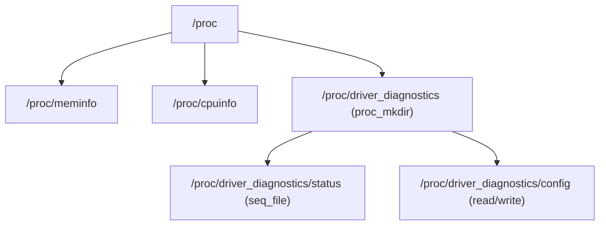
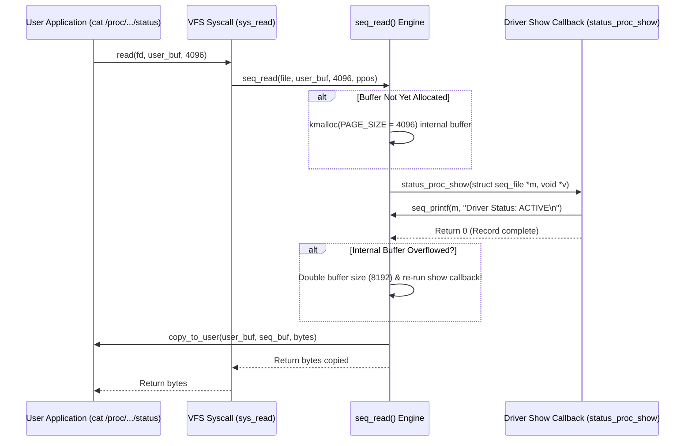

# Chapter 09: Procfs Diagnostic Interface & Kernel seq_file Subsystem

The `/proc` filesystem is one of the most visible and historic components of UNIX and Linux operating systems. Unlike persistent filesystems (such as ext4 or Btrfs) that store blocks on non-volatile media, `/proc` is an **in-memory, pseudo-filesystem** generated dynamically by the kernel on demand.

In device driver development, `/proc` is the premier interface for exposing diagnostic statistics, device health metrics, operational mode dumps, and runtime administrative knobs.

---

## 1. Procfs Architecture & Evolution

Every file and directory in `/proc` corresponds to an internal kernel data structure (`struct proc_dir_entry`):



### The Transition to `struct proc_ops` (Linux 5.6+)
Historically, procfs entries used the general VFS `struct file_operations`. However, `file_operations` contains dozens of pointers intended for real disk and network filesystems (`mmap`, `fsync`, `fasync`, `fallocate`, `splice_read`, `copy_file_range`).

In kernel 5.6, commit `d56c0d45f0e2` replaced `file_operations` with **`struct proc_ops`**:
- Reduces kernel memory footprint across thousands of proc entries.
- Explicitly isolates proc-specific behaviors (`proc_open`, `proc_read`, `proc_write`, `proc_lseek`, `proc_release`).
- Prevents drivers from inadvertently implementing inappropriate VFS semantics.

---

## 2. The Pagination Problem & The `seq_file` Solution

### Why Naive `proc_read()` Fails
Consider a naive driver that creates a proc entry and returns text in a custom read function:

```c
/* NAIVE ANTI-PATTERN - DO NOT USE IN PRODUCTION */
static ssize_t bad_proc_read(struct file *file, char __user *buf, size_t count, loff_t *ppos)
{
    char kbuf[512];
    int len = snprintf(kbuf, sizeof(kbuf), "Telemetry data...\n");
    if (*ppos >= len)
        return 0; // EOF
    copy_to_user(buf, kbuf, len);
    *ppos += len;
    return len;
}
```

This breaks under standard user-space access:
1. **Paging Boundaries**: If the data exceeds `PAGE_SIZE` (4096 bytes), standard `read()` calls will be truncated.
2. **Buffer Splitting**: If a tool like `dd` or `python` reads with a small chunk size (e.g. `read(fd, buf, 64)`), tracking `*ppos` across dynamic text formatting becomes error-prone and causes duplicate or missing lines.
3. **Memory Sizing**: Allocating large static buffers in kernel stack memory risks a kernel stack overflow (default stack is only 16KB on x86_64).

---

## 3. The `seq_file` Subsystem Architecture

The **`seq_file`** (sequential file) subsystem was engineered specifically to solve the multi-page pagination problem:



### The `single_open()` Helper
For diagnostic views that represent a single snapshot of data (fitting within a few pages), the kernel provides `single_open()`:

```c
static int status_proc_show(struct seq_file *m, void *v)
{
    mutex_lock(&g_stats.lock);
    seq_printf(m, "Driver Status        : ACTIVE\n");
    seq_printf(m, "Diagnostic Reads     : %u\n", g_stats.total_reads);
    mutex_unlock(&g_stats.lock);
    return 0;
}

static int status_proc_open(struct inode *inode, struct file *file)
{
    return single_open(file, status_proc_show, NULL);
}

static const struct proc_ops status_proc_ops = {
    .proc_open    = status_proc_open,
    .proc_read    = seq_read,
    .proc_lseek   = seq_lseek,
    .proc_release = single_release,
};
```

---

## 4. Safe Read-Write Proc Entries & Defensive Parsing

When implementing writable proc entries (e.g. `/proc/driver_diagnostics/config`):
1. **Bound Buffer Sizing**: Limit incoming data to a fixed maximum (e.g. `min(count, sizeof(kbuf) - 1)`).
2. **Strip Whitespace**: Always strip `\n` and `\r` before parsing.
3. **Use Safe String Helpers**:
   - `kstrtoint()` or `kstrtoul()` instead of `sscanf()` or `simple_strtoul()`.
   - `strscpy()` instead of `strncpy()`.
4. **Synchronization**: Always acquire a `struct mutex` around shared state to ensure concurrent readers and writers see consistent updates.

---

## 5. Directory Trees & Recursive Cleanup

Modern drivers create dedicated directory subtrees rather than cluttering the top-level `/proc`:
```c
/* Create /proc/driver_diagnostics */
proc_dir_root = proc_mkdir("driver_diagnostics", NULL);

/* Create entries within directory */
proc_entry_status = proc_create("status", 0444, proc_dir_root, &status_proc_ops);
proc_entry_config = proc_create("config", 0666, proc_dir_root, &config_proc_ops);
```

During module cleanup, the single function **`proc_remove(proc_dir_root)`** recursively unlinks the directory and all contained children safely:
```c
static void __exit procfs_module_exit(void)
{
    proc_remove(proc_dir_root);
}
```

---

## 6. Summary & Key Takeaways

1. **Diagnostic Standard**: Procfs is ideal for human-readable diagnostic dumps and text-based tuning.
2. **Modern API**: Always use `struct proc_ops` on Linux 5.6+.
3. **Scale with `seq_file`**: Use `single_open()` and `seq_printf()` to ensure robust pagination and eliminate buffer overflow risks.
4. **Defensive Parsing**: Use `kstrtoint()` and enforce bounds to protect kernel state against malicious or malformed inputs.
