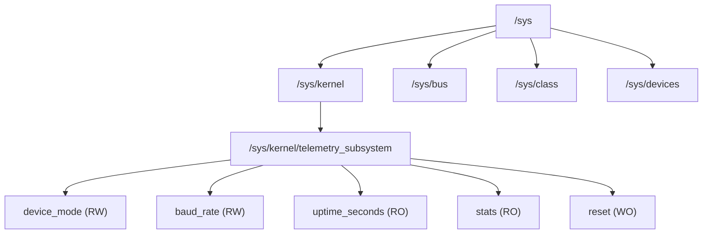

# Chapter 10: Sysfs & Kernel Objects (kobject, attributes, groups)

The Linux **sysfs** filesystem is an in-memory virtual filesystem mounted at `/sys`. While `/proc` focuses primarily on process introspection and system diagnostics, `/sys` provides a clean, strictly organized hierarchical representation of the **Linux Device Model**: buses, devices, classes, drivers, and kernel objects.

---

## 1. Architectural Role of Sysfs

Sysfs serves three core functions in modern Linux:
1. **Device Hierarchy Representation**: Visualizes parent-child relationships across buses (PCIe, USB, I2C, SPI, platform).
2. **Hardware Configuration & Telemetry**: Exposes granular, readable and writable knobs to user space without needing custom IOCTLs.
3. **Event Notification (uevents)**: Emits kernel uevents via Netlink sockets to user-space daemons like `systemd-udevd` whenever devices or attributes change.



---

## 2. The Core Entity: `struct kobject`

Every directory in `/sys` is backed by a `struct kobject` in kernel memory:

```c
struct kobject {
    const char          *name;
    struct list_head    entry;
    struct kobject      *parent;
    struct kset         *kset;
    const struct kobj_type *ktype;
    struct kernfs_node  *sd; /* sysfs directory node */
    struct kref         kref;
    ...
};
```

### Key Responsibilities of `kobject`:
1. **Reference Counting (`kref`)**: Tracks references to kernel memory. When the count drops to 0 via `kobject_put()`, its `release` callback is invoked to free resources safely.
2. **Hierarchical Tree**: The `parent` pointer builds the filesystem hierarchy. Setting `parent = kernel_kobj` places the directory under `/sys/kernel/`.
3. **Sysfs Representation**: When registered, sysfs creates the matching directory in userspace.

---

## 3. Sysfs Attributes & Modern API

A sysfs file represents an **attribute**. For standalone kobjects, attributes use `struct kobj_attribute`:

```c
struct kobj_attribute {
    struct attribute attr;
    ssize_t (*show)(struct kobject *kobj, struct kobj_attribute *attr, char *buf);
    ssize_t (*store)(struct kobject *kobj, struct kobj_attribute *attr, const char *buf, size_t count);
};
```

### Modern Formatting: `sysfs_emit()` vs `sprintf()`
In earlier kernels, developers frequently used `sprintf(buf, "%d\n", val)` or `snprintf()`.
Modern Linux kernels introduce **`sysfs_emit()`** and **`sysfs_emit_at()`**:
- Aware of the `PAGE_SIZE` boundary guaranteed by sysfs attribute buffers.
- Guarantees `NULL` termination and prevents memory overruns.
- Always returns the number of characters formatted (excluding `\0`), conforming directly to sysfs `show` return conventions.

```c
static ssize_t baud_rate_show(struct kobject *kobj, struct kobj_attribute *attr, char *buf)
{
    return sysfs_emit(buf, "%u\n", g_telemetry.baud_rate);
}
```

### Defensive Input Parsing
Kernel drivers must never trust user-space strings:
1. **Trailing Newlines**: Shell commands (`echo 115200 > baud_rate`) append `\n`. Using `sysfs_streq()` handles this cleanly without manual trimming.
2. **Safe Conversions**: `kstrtouint()`, `kstrtoint()`, and `kstrtobool()` perform strict boundary and radix checking, returning `-EINVAL` or `-ERANGE` on invalid syntax.

---

## 4. The "One Value Per File" Philosophy

A defining design standard of Linux sysfs is:
> **One attribute file should contain exactly one human-readable value (or an array of identical values), terminated by a single newline.**

### Why?
- Scriptable with simple shell tools (`cat`, `echo`, `awk`).
- Predictable parsing for monitoring agents (e.g., Prometheus node_exporter, collectd).
- High scalability without pagination complexity (unlike multi-page procfs files).

Exceptions are permitted for formatted diagnostic summaries (like `stats`), but separate single-value attributes (`device_mode`, `baud_rate`) are preferred for individual knobs.

---

## 5. Attribute Groups

Instead of creating attributes individually with `sysfs_create_file()`, production drivers group attributes into a `struct attribute_group`:

```c
static struct attribute *telemetry_attrs[] = {
    &dev_attr_device_mode.attr,
    &dev_attr_baud_rate.attr,
    &dev_attr_uptime_seconds.attr,
    &dev_attr_stats.attr,
    &dev_attr_reset.attr,
    NULL,
};

static const struct attribute_group telemetry_attr_group = {
    .attrs = telemetry_attrs,
};
```

### Benefits:
- **Atomic Creation**: `sysfs_create_group()` registers all files in one operation.
- **Race Condition Prevention**: Prevents user-space udev rules from triggering while attributes are only partially exposed.
- **Clean Cleanup**: `sysfs_remove_group()` tears down all nodes atomically during module exit.
