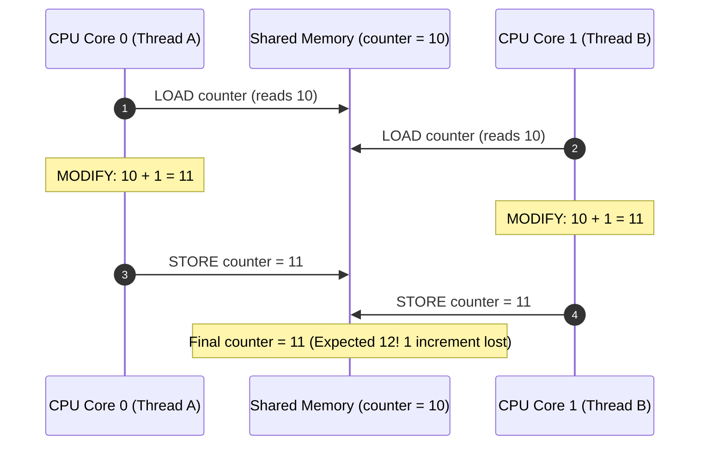
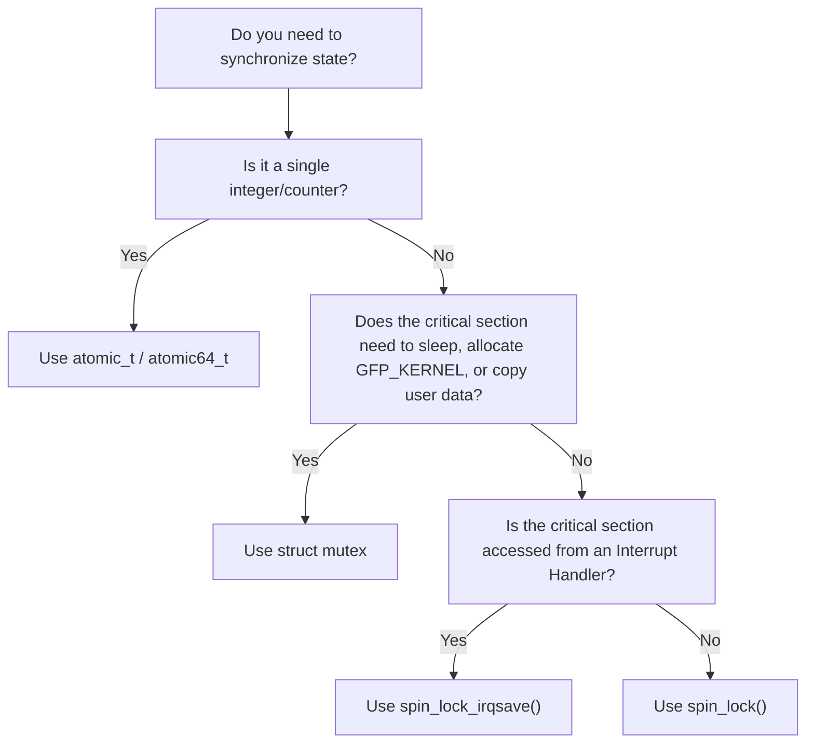

# Chapter 11: Concurrency, Synchronization & Locking in Linux Drivers

Modern operating system kernels run on symmetric multiprocessing (SMP) hardware where multiple CPU cores execute kernel code simultaneously. In addition, preemptible kernels and hardware interrupt handlers can interrupt running code at arbitrary assembly instructions.

Writing robust device drivers requires mastering Linux kernel concurrency models and synchronization primitives.

---

## 1. Anatomy of a Race Condition

Consider the seemingly innocuous line of C code:
```c
counter++;
```

At the assembly level on an x86_64 or ARM64 processor, this translates into three distinct micro-architectural operations:
1. **LOAD**: Read the value from memory into a CPU register (`mov (%rax), %rbx`).
2. **MODIFY**: Increment the register value (`inc %rbx`).
3. **STORE**: Write the register value back to memory (`mov %rbx, (%rax)`).



Because Core 0 and Core 1 interleaved their read and write cycles, Thread A's update was overwritten and silently lost.

---

## 2. Kernel Synchronization Primitives

The Linux kernel provides specialized locking primitives tailored to different execution contexts:

### 2.1 Atomic Variables (`atomic_t` / `atomic64_t`)
Atomics use hardware-locked bus cycles (e.g. `LOCK XADD` on x86, or Load-Linked / Store-Conditional `LDREX`/`STREX` on ARM) to make read-modify-write operations indivisible.

```c
#include <linux/atomic.h>

atomic64_t counter = ATOMIC64_INIT(0);

atomic64_inc(&counter);           /* Lockless increment */
u64 val = atomic64_read(&counter); /* Atomic read */
atomic64_set(&counter, 100);       /* Atomic set */
```

- **Pros**: Zero lock contention overhead, lockless, impossible to deadlock.
- **Cons**: Limited to single-variable numeric operations. Cannot protect complex data structures.

---

### 2.2 Spinlocks (`spinlock_t`)
A spinlock is a mutual exclusion mechanism where a thread attempting to acquire an unavailable lock actively loops ("spins") in a tight CPU cycle until the lock is released:

```c
#include <linux/spinlock.h>

spinlock_t my_lock;
spin_lock_init(&my_lock);

spin_lock(&my_lock);
/* Critical section: short, non-blocking */
spin_unlock(&my_lock);
```

#### The Golden Rules of Spinlocks:
1. **Never sleep while holding a spinlock**:
   - Do NOT call `msleep()`, `schedule()`, or allocate memory with `GFP_KERNEL`.
   - Do NOT perform I/O or copy data from/to user space (`copy_from_user` can page fault and sleep).
2. **Use `spin_lock_irqsave` in code shared with interrupt handlers**:
   ```c
   unsigned long flags;
   spin_lock_irqsave(&my_lock, flags);
   /* Safe against local CPU IRQs */
   spin_unlock_irqrestore(&my_lock, flags);
   ```

---

### 2.3 Mutexes (`struct mutex`)
A mutex is a sleepable lock designed for process context. If a thread attempts to acquire an occupied mutex, the kernel scheduler places the thread into a wait queue and context switches to another runnable process.

```c
#include <linux/mutex.h>

struct mutex my_mutex;
mutex_init(&my_mutex);

if (mutex_lock_interruptible(&my_mutex))
    return -ERESTARTSYS; /* Interrupted by signal like Ctrl+C */

/* Sleepable critical section */
copy_to_user(...);

mutex_unlock(&my_mutex);
```

#### Mutex Rules:
- Only usable in **process context** (where `in_interrupt() == false`).
- Attempting to acquire a mutex in an interrupt handler causes a fatal kernel panic (`scheduling while atomic`).
- Supports priority inheritance to prevent priority inversion.

---

## 3. Decision Matrix: Choosing the Right Primitive


