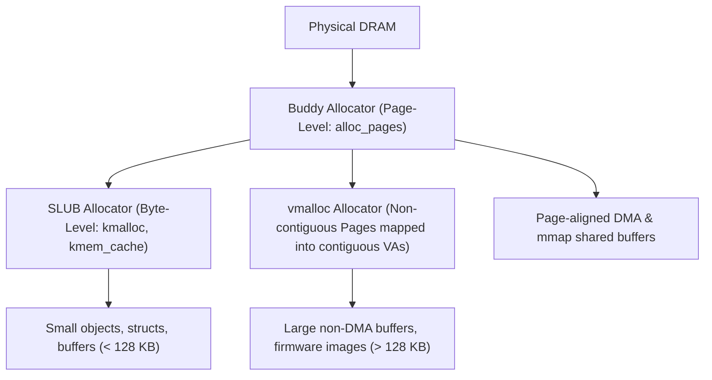

# Chapter 12: Kernel Memory Management & Zero-Copy mmap Architecture

Memory management is at the core of operating system design. In device driver development, efficient memory handling dictates whether a driver can process high-throughput data streams (such as video frames, network packets, or sensor telemetry) without exhausting CPU cycles or system bus bandwidth.

---

## 1. Kernel Memory Allocators: A Comparative Analysis

The Linux kernel provides several memory allocation interfaces, each optimized for specific constraints:



### 1.1 `kmalloc()`
- **Allocation Units**: Bytes (powers of two, from 32 bytes up to ~128 KB–4 MB depending on config).
- **Physical Contiguity**: **Physically contiguous** and virtually contiguous.
- **Speed**: Extremely fast (cached in SLUB slabs).
- **Context**: Can be called from interrupt context with `GFP_ATOMIC`.

### 1.2 `vmalloc()`
- **Allocation Units**: Virtually contiguous memory assembled from arbitrary, potentially scattered physical pages.
- **Physical Contiguity**: **NOT physically contiguous**.
- **Page Table Overhead**: Modifies kernel master page tables to establish contiguous virtual addresses.
- **Constraints**: Slower than `kmalloc`. Cannot be used for direct DMA transfers. Cannot be called in interrupt context.

### 1.3 `alloc_pages()` & `get_zeroed_page()`
- **Allocation Units**: Exact page counts ($2^{order}$ pages, where $4096 \text{ bytes} \times 2^{order}$).
- **Physical Contiguity**: Guaranteed physically contiguous by the Buddy Allocator.
- **Suitability**: The ideal choice for buffers shared with user-space via `mmap()` or hardware DMA controllers.

---

## 2. Common `GFP` (Get Free Page) Flags

When requesting memory, drivers provide allocation flags indicating execution context and memory zone:

| Flag | Context | May Sleep? | Use Case |
| :--- | :---: | :---: | :--- |
| **`GFP_KERNEL`** | Process context | ✅ YES | Normal driver allocations; kernel may block or swap to free memory. |
| **`GFP_ATOMIC`** | Interrupt / Atomic | ❌ NO | Never sleeps; uses emergency memory reserves. Safe for IRQ handlers and spinlock critical sections. |
| **`__GFP_ZERO`** | Any | Depends | Clears memory to all zeros before returning. |
| **`GFP_DMA`** | Process/Atomic | Depends | Allocates from lower 16MB of physical RAM (for legacy ISA/32-bit DMA). |

---

## 3. The `mmap()` Subsystem & Zero-Copy Architecture

Traditional file operations require copying data through two address spaces:
```text
User Memory  <--- (copy_to_user) ---  Kernel Memory  <---  Hardware Device
```

With `mmap()`, the driver bypasses buffer copying entirely:
```text
User Virtual Address  \
                        ===> [ Shared Physical DRAM Page ] <=== Hardware Device
Kernel Virtual Address /
```

### 3.1 Page Frame Numbers (PFN)
Physical RAM is partitioned into fixed-size chunks called **Page Frames** (usually 4 KB on x86/ARM).
A **Page Frame Number (PFN)** is the physical index of a frame:
$$\text{PFN} = \frac{\text{Physical Address}}{\text{PAGE\_SIZE}} = \text{Physical Address} \gg 12$$

In Linux driver code:
```c
struct page *page = virt_to_page(kbuf);
unsigned long pfn = page_to_pfn(page);
```

### 3.2 `remap_pfn_range()`
The core function that binds physical frames to user virtual memory:
```c
int remap_pfn_range(struct vm_area_struct *vma,
                    unsigned long addr,
                    unsigned long pfn,
                    unsigned long size,
                    pgprot_t prot);
```

- `vma`: The Virtual Memory Area allocated by the kernel VFS for this user process.
- `addr`: The user virtual start address (`vma->vm_start`).
- `pfn`: The starting physical Page Frame Number.
- `size`: The byte length of the range to map.
- `prot`: Page protection attributes (`vma->vm_page_prot`).

### 3.3 Pinning Shared Pages with `SetPageReserved`
Before mapping a kernel-allocated page to userspace, the driver must mark it reserved:
```c
SetPageReserved(virt_to_page(kbuf));
```
This informs the Linux Virtual Memory Subsystem that this page is pinned and must not be swapped out, migrated, or reclaimed. Upon unloading, the reservation is cleared:
```c
ClearPageReserved(virt_to_page(kbuf));
free_page((unsigned long)kbuf);
```
