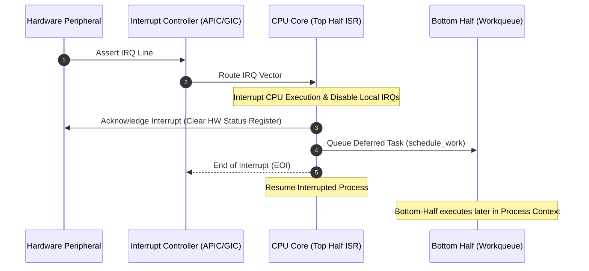

# Chapter 13: Hardware & Shared Interrupt Handling (request_irq, IRQF_SHARED, Top-Half ISR)

Interrupt handling is the fundamental mechanism allowing hardware devices to notify the central processing unit (CPU) of asynchronous events. Operating systems cannot afford to poll hardware in tight loops; instead, modern Linux kernels rely on interrupt controllers and interrupt service routines to respond instantly to hardware events.

---

## 1. Hardware Interrupt Flow

When hardware signals an interrupt:
1. The hardware line pulses (edge or level triggered).
2. The Interrupt Controller (Advanced Programmable Interrupt Controller - APIC on x86, or Generic Interrupt Controller - GIC on ARM) routes the interrupt to an active CPU core.
3. The CPU saves its program counter and status registers on the kernel interrupt stack.
4. The kernel invokes the registered **Top-Half Interrupt Service Routine (ISR)**.
5. The ISR acknowledges the hardware line, reads immediate register state, and returns `IRQ_HANDLED`.
6. If heavy processing is required, the ISR schedules a **Bottom Half** (Workqueue / Threaded IRQ) and exits immediately.



---

## 2. Registering an ISR: `request_irq()`

```c
int request_irq(unsigned int irq,
                irq_handler_t handler,
                unsigned long flags,
                const char *name,
                void *dev_id);
```

### Parameters:
- `irq`: The interrupt number being requested.
- `handler`: Pointer to the ISR callback (`irqreturn_t handler(int irq, void *dev_id)`).
- `flags`: Bitmask controlling line behavior:
  - `IRQF_SHARED`: Permits multiple drivers to share the same physical IRQ line.
  - `IRQF_TRIGGER_RISING` / `IRQF_TRIGGER_FALLING`: Configures edge-triggering.
  - `IRQF_ONESHOT`: Keeps the IRQ line masked until the threaded handler finishes (used with `request_threaded_irq`).
- `name`: ASCII string identifying the device in `/proc/interrupts`.
- `dev_id`: Unique cookie passed to the handler. For shared IRQs, `dev_id` **must be non-NULL and unique** (usually pointer to driver state struct) so `free_irq()` knows which handler to remove.

---

## 3. Top-Half Constraints & Interrupt Context

The Top-Half ISR runs in **interrupt context**, meaning:
1. **There is no backing process context**: `current` pointer is invalid or refers to whichever arbitrary process happened to be interrupted.
2. **Sleeping is strictly prohibited**:
   - Calling `msleep()`, `schedule()`, or waiting on semaphores/waitqueues causes a fatal kernel oops: `BUG: scheduling while atomic`.
   - Acquiring a `struct mutex` is forbidden.
   - Allocating memory with `GFP_KERNEL` is forbidden (must use `GFP_ATOMIC`).
   - Transferring data via `copy_to_user()` / `copy_from_user()` is forbidden because page faults require sleeping.

---

## 4. Shared Interrupt Conventions

When an interrupt line is shared (`IRQF_SHARED`):
- All registered handlers for that IRQ are stored in a linked list.
- When the interrupt fires, the kernel invokes **each handler sequentially**.
- Each handler must check its device registers to see if its specific hardware fired:
  - If yes: Acknowledge hardware, service event, and return `IRQ_HANDLED`.
  - If no: Immediately return `IRQ_NONE` so other drivers can service it.
- If all handlers return `IRQ_NONE` repeatedly, the kernel detects an unhandled spurious interrupt and reports `irq XX: nobody cared`.

