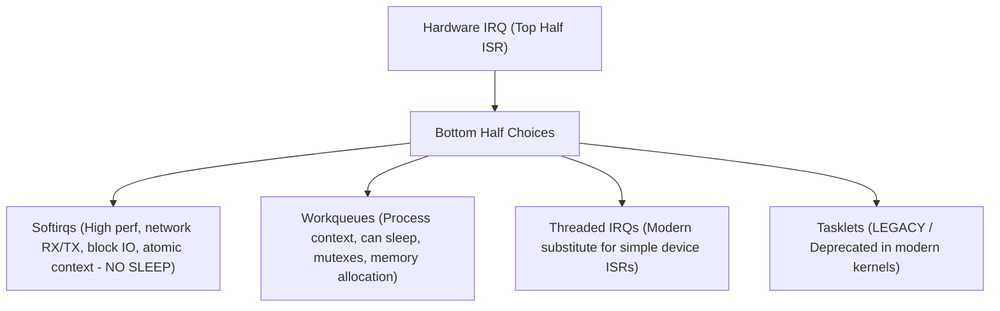

# Chapter 14: Deferred Work & Workqueues (schedule_work, alloc_workqueue, delayed_work)

When a hardware interrupt fires, the Linux kernel must service the event promptly to avoid missing subsequent interrupts or causing system latency spikes. However, hardware servicing frequently requires complex tasks: allocating dynamic memory, computing checksums, or communicating with hardware controllers over slow serial buses (I2C, SPI, MDIO).

To bridge this gap, Linux divides interrupt processing into two phases: **Top Half** and **Bottom Half**.

---

## 1. Evolution of Linux Bottom-Half Mechanisms

Over thirty years of Linux kernel development, bottom-half mechanisms have evolved dramatically:



### 1.1 Softirqs
- Static compile-time registered tables (e.g. `NET_TX_SOFTIRQ`, `NET_RX_SOFTIRQ`, `TIMER_SOFTIRQ`, `RCU_SOFTIRQ`).
- Run in software interrupt context.
- Can execute concurrently on multiple CPUs.
- **Cannot sleep** (cannot acquire mutexes or block).

### 1.2 Tasklets (Deprecated)
- Historically built on top of `TASKLET_SOFTIRQ`.
- Strictly serialized per-tasklet across CPUs.
- Deprecated in modern Linux 6.x/7.x in favor of threaded IRQs and workqueues.

### 1.3 Workqueues (CMwq)
- Introduced in Linux 2.6 and overhauled as **Concurrency Managed Workqueues (CMwq)** in 2.6.36.
- Run in **process context** as `kworker/u:X` kernel threads.
- **Can sleep**, block, wait for I/O, allocate `GFP_KERNEL` memory, and acquire mutexes.
- Automatically adjusts kernel thread pool concurrency to maximize CPU utilization without overflowing threads.

---

## 2. Workqueue API Architecture

### 2.1 Default System Workqueue (`system_wq`)
For lightweight or infrequent tasks, drivers can schedule directly on the kernel's shared workqueue:
```c
#include <linux/workqueue.h>

struct work_struct my_work;

void my_work_handler(struct work_struct *work)
{
    /* Runs in kworker process context */
    msleep(10); /* Safe to sleep! */
}

/* Initialization */
INIT_WORK(&my_work, my_work_handler);

/* Scheduling */
schedule_work(&my_work);
```

### 2.2 Dedicated Workqueue (`alloc_workqueue`)
For drivers with latency-sensitive tasks or heavy workloads that must not starve other drivers:
```c
struct workqueue_struct *my_wq;
my_wq = alloc_workqueue("my_device_wq", WQ_UNBOUND, 1);

/* Scheduling on private workqueue */
queue_work(my_wq, &my_work);

/* Cleanup */
flush_workqueue(my_wq);
destroy_workqueue(my_wq);
```

### 2.3 Delayed Work (`struct delayed_work`)
Combines a kernel timer with a work item. The work item is only queued after the specified jiffies interval has elapsed:
```c
struct delayed_work my_dwork;

INIT_DELAYED_WORK(&my_dwork, my_dwork_handler);

/* Schedule to run after 250 milliseconds */
schedule_delayed_work(&my_dwork, msecs_to_jiffies(250));

/* Synchronous cancellation */
cancel_delayed_work_sync(&my_dwork);
```
