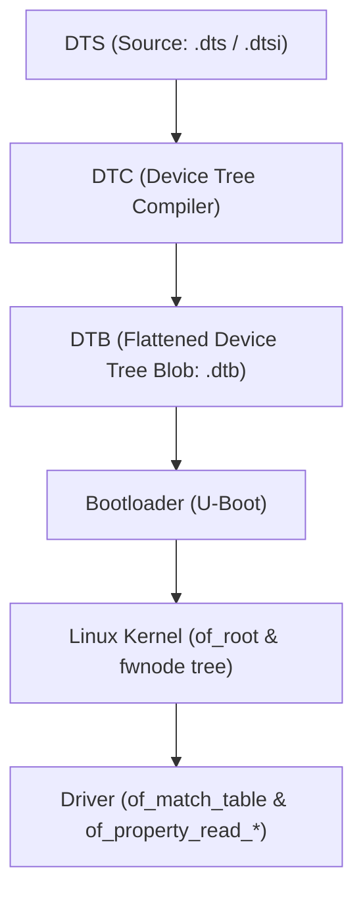

# Chapter 17: Device Tree Simulation & OF Property Parsing

Historically, embedded ARM Linux kernels contained thousands of lines of board-specific C files in `arch/arm/mach-*` with hardcoded structs for every LED, button, and sensor. In 2011, Linus Torvalds mandated the transition to **Device Trees (Open Firmware)** to decouple the operating system binary from hardware descriptions.

---

## 1. Device Tree Architecture

A Device Tree is a tree data structure describing the non-discoverable components attached to a system:

```text
/ {
    model = "Acme IoT Gateway V2";
    compatible = "acme,gateway-v2";

    soc {
        #address-cells = <1>;
        #size-cells = <1>;

        i2c@44e0b000 {
            compatible = "ti,omap4-i2c";
            reg = <0x44e0b000 0x1000>;
            interrupts = <70>;

            sensor@48 {
                compatible = "packt,custom-sensor";
                reg = <0x48>;
                clock-frequency = <400000>;
                sensor-label = "ACCEL_GYRO_V2";
            };
        };
    };
};
```



---

## 2. Open Firmware Matching in Linux Drivers

Drivers declare supported hardware via `struct of_device_id`:

```c
static const struct of_device_id my_of_match[] = {
    { .compatible = "packt,custom-sensor", .data = (void *)1 },
    { .compatible = "packt,custom-sensor-v2", .data = (void *)2 },
    { /* Sentinel */ }
};
MODULE_DEVICE_TABLE(of, my_of_match);
```

When a device node with matching `.compatible` is parsed by the kernel, the platform bus matches the device and invokes `probe()`.

---

## 3. Property Extraction APIs

### Legacy OF vs Modern Unified `device_property_*`
In older codebases, drivers called `of_property_read_u32()` directly. However, this required `#ifdef CONFIG_OF` guards and prevented running on ACPI-based systems (like x86 servers or Windows on ARM).

Modern Linux drivers use `<linux/property.h>`:
```c
#include <linux/property.h>

u32 freq;
const char *name;
bool power_save;

/* Automatically resolves against OF nodes, ACPI, or Software Nodes */
device_property_read_u32(&pdev->dev, "clock-frequency", &freq);
device_property_read_string(&pdev->dev, "sensor-label", &name);
power_save = device_property_read_bool(&pdev->dev, "power-saving");
```

---

## 4. Device Tree Overlays

**Device Tree Overlays (`.dtbo`)** permit dynamic modification of the running kernel device tree at runtime:
- Expanding Capes on BeagleBone.
- Attaching HATs on Raspberry Pi.
- Adding daughterboards on industrial carrier boards.

An overlay targeting a node injects child nodes or modifies properties using `fragment` and `__overlay__` blocks without rebooting the system.

