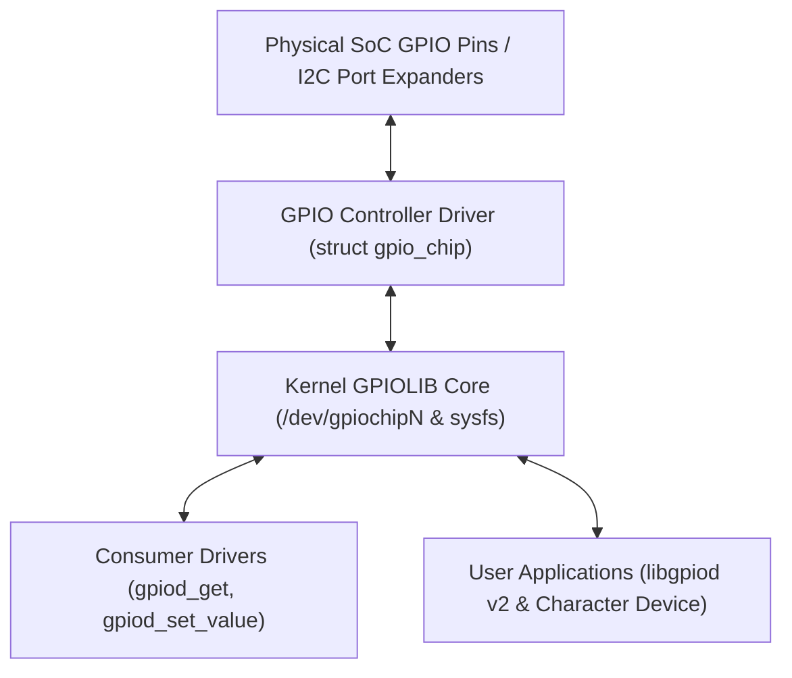

# Chapter 18: GPIO Subsystem & Modern Descriptor-Based gpiod Consumer API

General Purpose Input/Output (GPIO) pins are the simplest and most widespread interface in embedded systems. From toggling LEDs, reading pushbuttons, asserting chip-select lines, to power sequencing, GPIO handling is foundational to hardware drivers.

---

## 1. GPIOLIB Architecture

The Linux **GPIOLIB** subsystem provides a clean separation between **GPIO Controllers (Providers)** and **Device Drivers (Consumers)**:



---

## 2. Implementing a Controller: `struct gpio_chip`

A driver controlling hardware pins implements `struct gpio_chip`:

```c
#include <linux/gpio/driver.h>

struct gpio_chip chip = {
    .label            = "my_soc_gpio",
    .base             = -1, /* Dynamic allocation */
    .ngpio            = 32,
    .can_sleep        = false,
    .get_direction    = my_get_direction,
    .direction_input  = my_direction_input,
    .direction_output = my_direction_output,
    .get              = my_get_pin,
    .set              = my_set_pin,
};

gpiochip_add_data(&chip, &my_priv_data);
```

### The `can_sleep` Distinction
- If the GPIOs are accessed via direct memory-mapped register writes (SoC internal GPIOs), `can_sleep = false`. Driver functions run fast under spinlocks.
- If the GPIOs sit behind an I2C/SPI port expander (e.g. PCF8574, MCP23017), `can_sleep = true`. Consumers must use `gpiod_set_value_cansleep()`.

---

## 3. The Consumer API: Why Descriptors Win

In legacy Linux:
```c
/* Legacy Anti-pattern */
gpio_request(15, "reset_pin");
gpio_direction_output(15, 0);
```
If pin 15 is configured active-low in the hardware schematic, the developer had to manually invert every write (`gpio_set_value(15, !val)`).

With modern `struct gpio_desc`:
```c
/* Modern Descriptor Pattern */
struct gpio_desc *reset_gpio = devm_gpiod_get(&pdev->dev, "reset", GPIOD_OUT_LOW);
gpiod_set_value(reset_gpio, 1); /* Assert reset (GPIOLIB handles active-low inversion automatically!) */
```
- **Automatic Inversion**: The Device Tree property `gpios = <&gpio1 15 GPIO_ACTIVE_LOW>` is honored automatically by GPIOLIB. Setting `1` asserts the logical signal, regardless of whether hardware is active-high or active-low.
- **Resource Management**: Managed with `devm_gpiod_get()` to eliminate memory/resource leaks.
- **IRQs**: `gpiod_to_irq()` transparently maps a GPIO pin to a hardware IRQ number for `request_irq()`.
