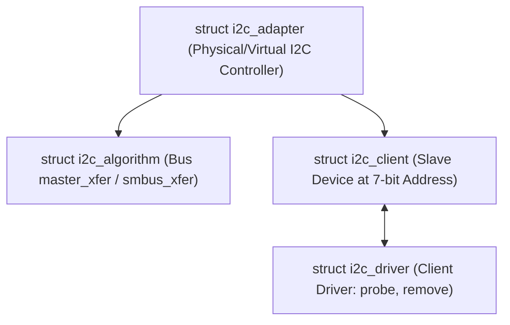

# Chapter 19: I2C Client Drivers & Sensor Emulation

The I2C (Inter-Integrated Circuit) protocol, invented by Philips (NXP), is the de facto standard for low-speed serial peripheral communication in hardware engineering.

---

## 1. Linux I2C Subsystem Hierarchy

The kernel models I2C through three core abstractions:



1. **`struct i2c_adapter`**: Represents the I2C host controller hardware (e.g. DesignWare I2C, Broadcom BSC, Intel i801).
2. **`struct i2c_algorithm`**: Defines how bits and bytes are clocked onto the bus (`master_xfer`).
3. **`struct i2c_client`**: Represents an individual slave chip sitting at a specific 7-bit (or 10-bit) address on an adapter.
4. **`struct i2c_driver`**: The driver controlling the client chip.

---

## 2. SMBus vs Plain I2C

**SMBus (System Management Bus)** is a subset of I2C with strict timing and predefined command protocols. Linux drivers prefer the **SMBus API** (`i2c_smbus_*`) over raw `i2c_transfer()` whenever possible because:
- SMBus functions work on both pure I2C controllers AND SMBus-only controllers (like Intel PC chipsets).
- SMBus provides standard transactional semantics (byte read, word read, block transfer).

### Standard SMBus Helpers:
- `i2c_smbus_read_byte_data(client, reg)`: Sends register address, reads 1 byte.
- `i2c_smbus_write_byte_data(client, reg, val)`: Sends register address and 1 data byte.
- `i2c_smbus_read_word_data(client, reg)`: Reads 16-bit word.
- `i2c_smbus_read_word_swapped(client, reg)`: Reads 16-bit word with byte swap (Big-Endian sensor to Little-Endian host).

---

## 3. Registering an I2C Client Driver

```c
#include <linux/i2c.h>

static int my_sensor_probe(struct i2c_client *client)
{
    /* client->addr holds the 7-bit slave address (e.g. 0x48) */
    /* client->adapter points to the bus */
    return 0;
}

static void my_sensor_remove(struct i2c_client *client)
{
}

static const struct i2c_device_id my_id_table[] = {
    { "lm75_temp_sensor", 0 },
    { }
};
MODULE_DEVICE_TABLE(i2c, my_id_table);

static struct i2c_driver my_driver = {
    .driver = { .name = "my_sensor", .owner = THIS_MODULE },
    .probe  = my_sensor_probe,
    .remove = my_sensor_remove,
    .id_table = my_id_table,
};
module_i2c_driver(my_driver);
```
