# Linux Kernel Driver Development: Beginner to Advanced Mastery

Welcome to the definitive hands-on curriculum for Linux Kernel Driver and Subsystem Development. This repository is structured to bridge the gap between theoretical operating system internals and production-grade kernel programming.

Each lab includes:
1. **Kernel Driver Code (`.c`)** written to modern Linux kernel coding standards (v6.x / v7.x+).
2. **Kbuild Makefile** with targets for building, loading, unloading, and monitoring.
3. **User-space Test Applications** where relevant (for character devices, IOCTL, mmap, etc.).
4. **Step-by-Step Lab Guides (`README.md`)** detailing exact commands, expected outputs, and troubleshooting.
5. **Deep-Dive Architecture Chapters in `/docs/`** covering kernel internals, memory models, hardware abstractions, and synchronization.

---

## 🗺️ Curriculum Roadmap

```mermaid
graph TD
    subgraph Phase1["Phase 1: Kernel Module Fundamentals"]
        M1["01: Hello World & Module Lifecycle"] --> M2["02: Module Parameters & Sysfs"]
        M2 --> M3["03: Multi-File Modules & Symbol Export"]
    end

    subgraph Phase2["Phase 2: Character Device Drivers"]
        M3 --> C1["04: Major & Minor Number Allocation"]
        C1 --> C2["05: cdev & File Operations (open, release, read, write)"]
        C2 --> C3["06: Dynamic Device Creation (class_create & udev)"]
        C3 --> C4["07: Safe User-Kernel Data Transfer (copy_to/from_user)"]
    end

    subgraph Phase3["Phase 3: Control Interfaces & Virtual Filesystems"]
        C4 --> I1["08: IOCTL (Command Encoding & Custom Control)"]
        I1 --> I2["09: Procfs Interface (proc_create, proc_ops)"]
        I2 --> I3["10: Sysfs & Kernel Objects (kobjects, attributes)"]
    end

    subgraph Phase4["Phase 4: Concurrency, Locking & Memory"]
        I3 --> K1["11: Concurrency & Synchronization (Spinlocks, Mutexes, Atomics, RCU)"]
        K1 --> K2["12: Kernel Memory Management (kmalloc, vmalloc, mmap, SLUB)"]
    end

    subgraph Phase5["Phase 5: Interrupts & Deferred Processing"]
        K2 --> H1["13: Hardware Interrupts (Top Half, IRQF_SHARED)"]
        H1 --> H2["14: Deferred Work (Workqueues & Threaded IRQs)"]
        H2 --> H3["15: Kernel Timers & Delays (timer_list, hrtimers, jiffies)"]
    end

    subgraph Phase6["Phase 6: The Linux Device Model & Hardware Buses"]
        H3 --> D1["16: Linux Device Model (Bus, Device, Driver, Platform Driver)"]
        D1 --> D2["17: Device Tree (DTS/DTB, OF Property Parsing)"]
        D2 --> D3["18: GPIO Subsystem (Modern gpiod Consumer API)"]
        D3 --> D4["19: I2C Client Drivers (i2c_driver, SMBus, Registers)"]
        D4 --> D5["20: DMA & Zero-Copy Architecture"]
    end

    subgraph Phase7["Phase 7: Advanced Subsystems & Kernel Diagnostics"]
        D5 --> S1["21: Network / USB / IIO Subsystems"]
        S1 --> S2["22: Tracing, Debugging & Panic Recovery (Ftrace, eBPF, KASAN, Lockdep)"]
    end
```

---

## 📚 Curriculum Breakdown

### **Phase 1: Kernel Module Fundamentals**
- [**01_hello_world**](file:///home/deepak/OPENSOURCE/LINUX_DRIVER/01_module_basics/01_hello_world/README.md) - Kernel module lifecycle, `__init`/`__exit`, `pr_fmt`, `pr_info`, Kbuild Makefile, `insmod`, `rmmod`, and `dmesg`.
- **02_module_parameters** - `module_param()`, parameter permissions, sysfs parameter modification at runtime, and callback validation.
- **03_export_symbols** - Multi-file compilation (`obj-m`, `mymod-objs`), symbol table (`/proc/kallsyms`), `EXPORT_SYMBOL()`, and inter-module dependencies.

### **Phase 2: Character Device Drivers**
- **04_major_minor_numbers** - Static (`register_chrdev_region`) vs Dynamic (`alloc_chrdev_region`) device allocation, `dev_t`, `MAJOR()`, `MINOR()`, and `/proc/devices`.
- **05_cdev_and_file_operations** - Initializing `struct cdev`, mapping VFS callbacks via `struct file_operations`, `struct file`, and `inode->i_cdev`.
- **06_device_nodes_udev** - Automating `/dev` node creation with `class_create()` and `device_create()`, avoiding manual `mknod`.
- **07_user_kernel_data_transfer** - Safe memory copy with `copy_to_user()` and `copy_from_user()`, address validity checks, handling partial transfers, and file offset management (`*f_pos`).

### **Phase 3: Control Interfaces & Virtual Filesystems**
- **08_ioctl** - Unlocked IOCTL handler, standard Linux ioctl numbering macros (`_IO`, `_IOR`, `_IOW`, `_IOWR`), type safety, and userspace test client.
- **09_procfs_interface** - Diagnostic interfaces using `proc_create()` with `struct proc_ops`, exporting system health data.
- **10_sysfs_and_kobjects** - sysfs tree architecture, `struct kobject`, `sysfs_create_group()`, and `DEVICE_ATTR_RW()` for clean hardware telemetry.

### **Phase 4: Concurrency, Synchronization & Memory**
- **11_concurrency_and_locking** - Protecting shared resources in SMP kernels: `atomic_t`, spinlocks (`spin_lock_irqsave`), mutexes (`mutex_lock`), and rules for atomic vs process contexts.
- **12_kernel_memory_management** - Dynamic allocation (`kmalloc`, `vmalloc`, GFP flags like `GFP_KERNEL` vs `GFP_ATOMIC`), page allocation (`alloc_pages`), and memory-mapping driver buffers to userspace with `remap_pfn_range` via `mmap`.

### **Phase 5: Interrupts & Deferred Processing**
- **13_interrupt_handling** - Hardware IRQ lines, `request_irq()`, interrupt context constraints (no sleeping!), shared IRQs (`IRQF_SHARED`).
- **14_deferred_execution** - Modern deferred work mechanisms: standard workqueues (`INIT_WORK`, `schedule_work`), dedicated workqueues, and threaded IRQs (`request_threaded_irq`).
- **15_timers_and_delays** - Jiffies, `HZ`, `timer_list` API (`timer_setup`, `mod_timer`), high-resolution timers (`hrtimer`), and delay mechanisms (`msleep` vs `mdelay`).

### **Phase 6: The Linux Device Model & Hardware Buses**
- **16_linux_device_model** - The unified kernel object model: Busses, Devices, and Drivers. Implementing Platform Devices & Platform Drivers (`platform_driver_register`, `probe`, `remove`).
- **17_device_tree** - Open Firmware (OF) device tree matching (`of_device_id`), parsing node properties (`of_property_read_u32`, `of_property_read_string`), and overlays.
- **18_gpio_subsystem** - Modern GPIO descriptor API (`<linux/gpio/consumer.h>`), GPIO control, and handling GPIO interrupts.
- **19_i2c_bus_driver** - `struct i2c_driver`, bus probing, register read/write using SMBus protocol, and simulated sensor device.
- **20_dma_engine** - Direct Memory Access: coherent (`dma_alloc_coherent`) vs streaming (`dma_map_single`) DMA buffers and scatter-gather lists.

### **Phase 7: Advanced Subsystems & Kernel Diagnostics**
- **21_subsystems** - Architecture of standard subsystems (Network `net_device`, USB `usb_driver`, Industrial I/O `iio_info`).
- **22_kernel_debugging_and_profiling** - Dynamic debug (`dyndbg`), Ftrace, eBPF tracing, Kprobes, memory leak detection with `Kmemleak`, lock debugging with `Lockdep`, and deciphering kernel panics.

---

## 🛠️ System Requirements & Quick Start

1. **Host OS**: Linux (x86_64 or ARM64)
2. **Kernel Headers**: `/lib/modules/$(uname -r)/build` must be installed.
   - On Arch Linux: `sudo pacman -S linux-headers`
   - On Ubuntu/Debian: `sudo apt install build-essential linux-headers-$(uname -r)`
   - On Fedora: `sudo dnf install kernel-devel kernel-headers`
3. **Compiler**: GCC and standard build tools (`make`).
